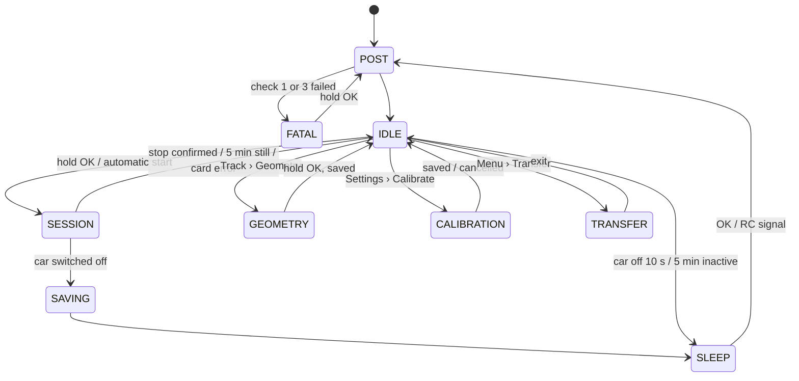

# RC Telemetry — ESP32 Firmware

Companion document to [PLAN.md](PLAN.md), which owns the system-level context, the monorepo layout
and the cross-project decisions. This file covers **only** the on-car device.

Authoritative elsewhere, referenced here: `docs/protocol.md` (`.rcl` binary format + BLE GATT),
`docs/hardware.md` (measured voltages and wiring), `docs/algorithms.md` (gate crossing, lap math).

---

## 1. System overview

A logger for electric RC cars, built on the **Seeed Studio XIAO ESP32-S3 Sense**. It is not tied to
one car: it moves between cars, and assumes nothing of them beyond a PWM receiver and a BEC rail
([PLAN.md](PLAN.md#target-cars)).

- **10 Hz GNSS** (Flywoo GOKU GM10 Nano V3.1, u-blox M10) over UART, UBX binary, no NMEA.
- **Driver inputs**: steering and throttle PWM tapped from the car's receiver.
- **Chassis motion**: external I²C IMU (accelerometer + gyro).
- **Storage**: microSD over the **SDMMC** bus (1-bit), records written in the `.rcl` binary format.
- **Phone link**: **BLE / GATT only**, and **only in Transfer mode**: no radio transmits near the
  receiver while the car is driven, so there is no live stream (§7.4). The ESP32-S3 has no Bluetooth
  Classic, so there is no SPP — see [PLAN.md](PLAN.md#hardware-findings-that-constrain-the-design).
- **Bulk transfer**: **USB Mass Storage** over USB-C, the device mounts as a disk.
- **Local UI**: a five-way navigation switch and a 0.96" 128×64 OLED on the I²C bus (§2.4, §3).
- **Sessions**: start and stop on their own when the car moves and stops, or by hand (§3.6).
- **On-device track logic**: start/finish line, lap and sector detection.
- **Boot**: a power-on self-test verifies every peripheral — the card included — before acquisition
  starts, and names what failed on the display (§3.3).

**Governing principle: the device is a recorder, not a summarizer.** No GNSS information is ever
discarded — every UBX message the receiver emits is persisted verbatim, and any loss that does occur
is counted and reported rather than passing silently (§5.3, §7.1). Decoding to a curated set of
fields happens in RAM for the display and the BLE status only; the file keeps everything, because a client
written a year from now may need a field nobody cares about today.

Not yet scoped: **power telemetry** — pack voltage, current and temperatures from sensors the device
carries itself, since ESC telemetry is brand-specific (§2.8).

Out of scope: OTA updates, WiFi.

---

## 2. Hardware

### 2.1 Pin map (`firmware/include/pins.h`)

`pins.h` is the single place pin assignments live. Pad → GPIO mapping per
[PLAN.md](PLAN.md#hardware-findings-that-constrain-the-design).

| Pad | GPIO | Function | Notes |
| --- | --- | --- | --- |
| D6 | 43 | UART1 TX → GPS RX | also U0TXD, see 2.2 |
| D7 | 44 | UART1 RX ← GPS TX | also U0RXD |
| D8 | 7 | SDMMC **CLK** | SPI SCK pad |
| D9 | 8 | SDMMC **DAT0** | SPI MISO pad |
| D10 | 9 | SDMMC **CMD** | SPI MOSI pad |
| — | 21 | SDMMC **DAT3** | not on a pad; board-to-board connector. Shared with the onboard user LED — see 2.3 |
| D4 | 5 | I²C SDA | display, IMU, GPS magnetometer if present, future ADS1115 |
| D5 | 6 | I²C SCL | |
| D0 | 1 | Five-way switch, resistor ladder on ADC1_CH0 | OK shorts it to GND; RTC-capable, so OK wakes the chip from deep sleep (§3.1, §4.5) |
| D1 | 2 | **spare** | freed by the display, which sits on the I²C bus — see 2.4 |
| D2 | 3 | RC throttle PWM in | GPIO3 is not the card's DAT3 — settled on the bench, see 2.2 |
| D3 | 4 | RC steering PWM in | |

Ten of the 11 pads are allocated. **D1 is the only spare GPIO**, kept for the aux channel (§8,
deferred and optional).

### 2.2 Unresolved hardware questions — Phase 1 blockers

~~**Which GPIO is the microSD chip-select / DAT3 line?**~~ **Resolved on the bench: GPIO21**, as
Seeed's code examples have it (`#define SD_CS 21`); the wiki page that says the slot "occupies GPIO3"
is wrong. A card picks SD or SPI mode at the first CMD0 after power-up, from DAT3, and ignores it
after that, so `tools/sd-dat3-test` held one candidate low per power-up: with GPIO3 low the card
mounted, with GPIO21 low it went to SPI mode and the mount failed (`docs/hardware.md`). D2/GPIO3 stays
the throttle input.

**Boot log on the GPS TX line.** GPIO43/44 are U0TXD/U0RXD. With `ARDUINO_USB_MODE=0` the
application console goes to USB CDC, but the **ROM bootloader still prints its startup banner on
GPIO43 at 115200 on every reset**, and GPIO46 — the strapping pin that would suppress it — is not
brought out. The GM10 discards malformed frames so this is harmless in practice, but: never assume
the GPS UART is quiet at boot, and re-apply the GNSS configuration after every reset (§5.2).

Other items to measure and record in `docs/hardware.md`:

- Per car: the receiver's channel-output logic level (3.3 V or 5 V, rarely in the datasheet) and the
  BEC voltage on the receiver rail. Neither is a design input any more — the front end of §2.5 and
  the regulator of §2.7 are sized for the whole range — but each car is checked against them once.
- Whether this GM10 V3.1 unit carries a magnetometer, and whether the module has config flash (§5.2).

Settled on the bench: the microSD socket needs **no external pull-ups** on CMD/DAT0, at 20 MHz or at
40 MHz (§2.3).

### 2.3 microSD over SDMMC

**Decision: SDMMC, not SPI.** The socket is wired to `SD_MMC`-capable pins and SDMMC is the better
bus, so no SPI path is implemented at all.

On the ESP32-S3 the SDMMC host is routed through the GPIO matrix, so the pads are mapped explicitly
before mounting:

```cpp
SD_MMC.setPins(PIN_SD_CLK /*7*/, PIN_SD_CMD /*9*/, PIN_SD_D0 /*8*/);
SD_MMC.begin("/sdcard", /*mode1bit=*/true, /*format_if_empty=*/false, SDMMC_FREQ_HIGHSPEED);
```

Constraints that follow from the board (bench results in `docs/hardware.md`):

- **1-bit mode only.** DAT1 and DAT2 are not brought out on the Sense expansion board, so 4-bit is
  impossible. **1-bit at 40 MHz works** with no external pull-ups: 3.5 MB/s write, 2.9 MB/s read on
  256 KB, data verified.
- **DAT3 must be high during card init** for the card to enter SD mode rather than SPI mode. DAT3 is
  GPIO21, which is *also* the onboard user LED (active low). Drive GPIO21 as an output HIGH before
  `SD_MMC.begin()` — conveniently that also keeps the user LED dark.
- **Cards: FAT32 on an MBR partition table, any capacity.** The core's FatFs is built without exFAT
  and without 64-bit LBA, so exFAT volumes and GPT disks do not mount; size is not the limit — a
  64 GB SDXC card formatted FAT32 works. Format with **32 KB clusters**: a card formatted by the
  ESP32 itself gets 512-byte clusters and writes three times slower. Hence `format_if_mount_failed`
  is always `false`: the firmware never formats a card.
- **The onboard user LED is unusable as a status indicator**, being electrically tied to the card's
  DAT3 line. The display of 2.4 is the status indicator.

Note on expectations: throughput was never the binding constraint — §4.4 puts the record stream at
about 3–4 KB/s, roughly a thousandth of the measured bus throughput. What SDMMC buys is lower
per-transaction overhead and headroom; **write-latency spikes are handled by buffering**, not by bus
choice.

### 2.4 Display

The status indicator is a **0.96" 128×64 SSD1306-compatible I²C OLED** (module and bench results in
`docs/hardware.md`). It is the device's only status indicator, chosen for three reasons:

- It **names** a failure in words rather than encoding it.
- It shows lap times and card space in the pits.
- Being on the I²C bus, it costs **no GPIO**, which is what freed D1 (§2.1).

What it takes:

- **Wiring:** VCC → 3V3, GND → GND, SDA → D4, SCL → D5 — the bus the IMU uses. Address 0x3C (0x3D on
  some modules); listings quoting 0x78 / 0x7A give the 8-bit form of the same two addresses.
- **3V3 only.** The module's pull-ups go to its VCC; on 5 V they would hold the bus above the
  ESP32-S3's 3.6 V maximum. The bus pull-ups come from the modules on it, so with the display's and an
  IMU breakout's in parallel, check that the combination stays above about 2 kΩ.
- **Bus budget — the one real cost.** A full 1 KB frame takes 31 ms at 400 kHz (measured,
  `docs/hardware.md`), six periods of the IMU's 200 Hz sampling (§2.6) on the same bus. Three rules keep the two compatible:
  1. The IMU samples into its own **FIFO** and is drained in bursts, so a display transfer delays a
     read but never costs a sample.
  2. The display sends only **dirty pages** (128 B, 3.9 ms each, measured) and refreshes at most
     at **5 Hz**.
  3. Every bus transaction goes through **one mutex**: the `ui` and `imu` tasks run on different cores
     (§4.1).
- **Driver: U8g2**, not the Adafruit library used on the bench. Its `updateDisplayArea()` provides
  rule 2, and it also drives the SH1106 used by 1.3" modules. Text comes in the two sizes of §3.2,
  both drawn on a 6-pixel grid for 21 columns: `u8g2_font_5x8_mr`, eight rows of one page each, and
  `u8g2_font_6x13B_mr`, picked on the bench for reading at arm's length (`docs/hardware.md`). A
  13-pixel row can straddle two pages, so the driver redraws every row that touches a dirty page.
- **Colours:** on the bench module rows 0–15 are yellow and the rest blue. The status bar of §3.2
  lives in that band; on single-colour modules it is just a band.
- **Wear:** an OLED burns in under static content. Dim it after 30 s without a key press, and
  switch it off in deep sleep.
- **Mechanics:** solder the headers — the bench showed that loose pins fail intermittently — and back
  the glass with foam. A car landing off a jump is hard on a glass panel.
- **Safe boot state:** none needed. The display does nothing until it is initialised over I²C, and
  it needs no GPIO driven early in `setup()`.

### 2.5 RC signal conditioning — do not skip this

Receiver outputs are 3.3 V **or** 5 V logic depending on make and model, and datasheets rarely say.
The ESP32-S3 absolute maximum on a GPIO is 3.6 V. Since the device moves between cars, the front end
must accept both without any adjustment.

1. **Measure each new receiver once** with a multimeter or scope on the steering signal pin while it
   is powered, and record it per car in `docs/hardware.md`. This is a check, not a design input: it
   catches the unexpected receiver whose signal swings far above 5 V, past what the clamp below is
   sized for.
2. Whatever the result, protect each input with **10 kΩ in series and a Schottky clamp to 3V3, a
   BAT43** (decided 2026-10-24, over the 74LVC2G17 buffer first planned: through-hole parts,
   solderable by hand on stripboard). A 5 V pulse drives about 0.15 mA through the BAT43 and holds
   the pin near 3.5 V, under its 3.6 V; the pin's own protection diode, with the higher forward drop,
   takes almost none of it. A receiver's PWM has clean edges, and 10 kΩ against the pin's few pF
   delays them by tens of nanoseconds, nothing against 1–2 ms pulses. The 74LVC2G17, a Schmitt
   buffer whose inputs tolerate 5.5 V, remains the alternative where a board is made.
3. A fixed resistor divider is **not** acceptable: sized for 5 V it produces ~2.0 V from a 3.3 V
   source, below the ESP32's ~2.48 V V_IH.
4. Share ground with the receiver. Do **not** connect the XIAO's 3V3 to the receiver's +V rail.
5. Fit a **~100 kΩ pull-down from each pin to ground**. With the car switched off the receiver is
   unpowered and its outputs float, and the RC inputs double as deep-sleep wake sources (§4.5): a
   floating input would wake the chip on noise. With the 10 kΩ in series it makes a divider, which
   leaves a 3.3 V receiver's high at about 3.0 V, still over the 2.48 V V_IH.

### 2.6 IMU

Not yet purchased, and **the XIAO Sense has no IMU** — it carries a camera and a microphone — so this
is an external I²C part on D4/D5.

Baseline choice: **LSM6DSO32** (±32 g accelerometer, ±2000 dps gyro, I²C 0x6A/0x6B). The ±32 g full
scale is the whole reason: a 1/8 off-road car landing off a jump exceeds ±16 g routinely, so the
more common ICM-42688-P and LSM6DSOX would clip on exactly the events most worth measuring. If a
±16 g part is used anyway, document the clipping in `docs/hardware.md` rather than pretending the data
is clean.

**Optional** (decided 2026-10-24). The device works without it, as it does today: POST check 7 is
degraded and the boot goes on, and a session's header gives the ranges as 0. Fitting it later costs
no pin: it shares the I²C bus with the display, at 0x6A against the display's 0x3C, and is read
through its FIFO, so its interrupt lines stay unwired — an interrupt would take D1, the aux
channel's. Mounting is the harder part in a car with little room: it must sit rigid on the
chassis, its axes along the car's, so inside the device's enclosure only if that is screwed to the
chassis rather than on foam; a breakout is about 25 × 18 mm. `car.kicad_sch` draws it crossed out,
not fitted (DNP).

### 2.7 Power

The ESC's BEC feeds the receiver rail, and its voltage depends on the ESC and on how it is
programmed: from 5 V up to 7.4–8.4 V on cars set up for high-voltage servos. Measure it on each car
and record it in `docs/hardware.md`. Anything above about 6 V is at or above the XIAO's onboard LDO
input limit and wastes it as heat.

- **A regulator for the whole range, 5–8.4 V in → 5.0 V out**, feeding the XIAO's 5V pad, which keeps
  the onboard LDO normal. **An LM2940CT-5.0**, a low-dropout linear regulator in
  TO-220, chosen on 2026-10-24 over the 100 %-duty buck first planned. Its dropout, 0.2 V at most at
  100 mA, lets a 5 V BEC through with little loss, as the buck would have. What it costs is heat on a
  high-voltage BEC: about (8.4 − 5.0) V × 200 mA ≈ 0.7 W, the current being an estimate until it is
  measured. TI guarantees it from 6.25 V in, so on the MP9e's 5.90 V BEC its 5.0 V is to be
  confirmed on the bench (`docs/hardware.md`). Its output needs **22 µF or more with an ESR of
  0.1–1 Ω**, or it oscillates: a low-ESR electrolytic, the Panasonic EEU-FR1C101 (100 µF 16 V,
  0.3 Ω at 100 kHz), never a ceramic alone, whose ESR is too low; the small dipped tantalums, 1.3–2 Ω
  at 47 µF, are too high. The CT grade is rated from 0 °C; the LM2940T-5.0 is the same part from
  −40 °C. Add 470 µF low-ESR bulk (EEU-FR1C471) + 100 nF at the input. The servo rail is
  electrically filthy — the steering servo draws large current spikes.
- **No diodes in the power path** (decided 2026-10-24). A servo plug cannot swap + and −, a LiPo's
  connector is keyed, and the LM2940 survives a reversed input on its own; nothing sits between its
  output and the 5V pad either. Hence one rule: **the USB is never plugged in while the car or a
  LiPo powers the board.** The two 5 V would meet on the 5V pad, and with the car off the USB would
  reach the receiver backwards through the LM2940, whose datasheet does not say what it does then.
  Unplug the board from the car to flash it or to read the card over USB.
- **Fit a small 1S LiPo (150–300 mAh) on the BAT pads.** This is the single highest-value reliability
  addition: it turns power-off into a graceful shutdown instead of a truncated, possibly corrupted SD
  file, and it keeps the GNSS BBR alive between runs — seconds to a hot fix instead of a 1–2 minute
  cold start. That last part holds **only if the GM10 is powered from a rail the LiPo keeps up**: on
  battery the 5V pad is dead, so a GM10 on 5 V loses its BBR in SLEEP (§9, question 16). Verify that
  the onboard charger works when powered from the 5V pad rather than USB.
- **Free power-loss detection:** the receiver dies at the same instant as the 5 V rail, so the
  **disappearance of RC PWM edges means the car was switched off** (§4.5). No pin required.
- There is no way to monitor the 5 V rail directly: the XIAO ESP32-S3 does not route battery or input
  voltage to an ADC internally, and no pad is left for an external divider. The PWM-edge watchdog is
  the only power-loss signal, which is why on the bench — receiver off — sessions end by the standstill
  timeout or by hand (§3.6).
- Enable the brownout detector, but understand what it is and is not for: see §4.5.

### 2.8 Power telemetry — ESC data is not portable

Many ESCs measure pack voltage, current, consumed capacity, their own temperature and motor RPM, and
some export it. But each brand does it its own way: telemetry sent back over the throttle signal
wire, a separate data or programming port, a proprietary bus. The protocols are mostly undocumented,
and many ESCs export nothing at all. A device meant to move between cars cannot depend on any of it.

Two consequences:

- **No ESC protocol is decoded.** Supporting brands one at a time is a project per brand, and every
  decoded field would remain a guess correlated against some other measurement.
- **The throttle input must tolerate such telemetry anyway.** Where an ESC sends data back over the
  throttle wire, the tap sees those bursts too, and the pulse validation of §4.3 has to reject them
  rather than record them as throttle. Which cars do this is noted per car in `docs/hardware.md`.

**The portable alternative.** One **ADS1115** on the I²C bus already anticipated in 2.1 buys four
analogue channels for **zero GPIOs**, read from sensors the device carries itself and so the same on
every car:

| Ch | Sensor | Gives |
| --- | --- | --- |
| A0 | Resistive divider off the pack | Pack voltage, per-cell average, sag under load |
| A1 | Hall-effect current sensor (e.g. ACS758-200B) in a pack lead | Current, and consumed mAh by integration |
| A2 | NTC on the ESC heatsink | ESC temperature |
| A3 | NTC on the motor can | Motor temperature |

Electrical notes: power the ADS1115 from the **5 V** rail — its I²C is open-drain, so 3V3 pull-ups
keep the bus at 3.3 V logic — which allows the ±6.144 V range and accommodates the ACS758's
5 V-referenced 0.5–4.5 V swing. Inputs must stay below VDD + 0.3 V regardless of the selected range,
so size the pack divider for about 4 V at the highest pack voltage supported — 25.2 V for 6S — rather
than for the nominal full scale.

That covers most of what ESC telemetry would have offered, identically on every car, with documented
parts, calibratable readings and host-testable conversion code. **Motor RPM is the one thing it cannot
give:** that needs an edge-counting GPIO on a divided-down motor phase wire, and D1, the only spare
GPIO, is already claimed twice over (§2.1).

This reopens a decision that belongs to the other document: [PLAN.md](PLAN.md#decisions-taken) records
pack-voltage sensing as out of scope. If an ADS1115 goes in for current and temperature anyway,
voltage comes free and that row should be revisited.

---

## 3. User interface — five-way switch, one display

### 3.1 Controls

The device has one input, an **E-Switch JS5208** five-way navigation switch: four tilt directions
and a centre push. It is wired as a resistor ladder onto D0 (§2.1), so it costs no more GPIOs than
the single button it replaced. It is an SMD part and not sealed, so it sits on a small carrier board
under a rubber boot.

- **Ladder.** The switch's common terminal goes to GND, with an external 10 kΩ pull-up from D0 to
  3V3. **OK**, the centre push, shorts D0 straight to GND — 0 V, which is also what wakes the chip
  from deep sleep (§4.5). UP, DOWN, LEFT and RIGHT go through 2.2 k, 4.7 k, 10 k and 22 k, giving
  about 0.6, 1.05, 1.65 and 2.27 V against 3.3 V at rest — which the ADC reads as about 3.12 V,
  where it saturates: at least 0.4 V between neighbouring levels.
- **Reading.** The `ui` task samples ADC1_CH0 at 100 Hz and sorts each sample into a voltage window;
  a key counts as pressed after two consecutive samples in the same window, which filters a contact
  bouncing and the windows the pin passes through between two levels. The windows are contiguous,
  so two keys at once read as one key, the lower-voltage one: OK with the two buttons, which is the
  safe outcome, and on the JS5208 — a single stick — it takes a diagonal tilt. The windows in
  `config.h` come from the bench measurements in `docs/hardware.md`; UP, DOWN and RIGHT stay nominal
  until the JS5208 is fitted.

| Key | Meaning everywhere, unless a screen says otherwise |
| --- | --- |
| **UP / DOWN** | Move the cursor or change page. Held, they repeat after 500 ms, every 200 ms |
| **OK short** (released before 800 ms) or **RIGHT** | Open, choose |
| **LEFT** | Back: Home ← Menu ← submenu. In an editor, cancel |
| **OK long** (held 1.5 s) | Perform the screen's action — start or stop a session, confirm. From 300 ms a **hold bar** fills (§3.2); it fires **at** 1.5 s while the key is still held, acknowledged by inverting the screen for 80 ms. Released earlier, nothing happens |
| Any key | While a full-screen error is shown, the first press only closes it (§3.2) |

**Getting back never needs a held key.** Every list and every editor ends with a **Back** entry, and
on a screen that is neither — an information screen such as GNSS or About — OK goes back, while its
action, if it has one, is a hold. LEFT, or NAV held with the two buttons, remains a shortcut.

**Two buttons, in the car too** (decided 2026-10-24): the layout below, first meant as the interim
one, is the one built; the JS5208 stays a later option, a resistor and a setting away.

**Interim layout: two buttons.** Until the JS5208 is fitted, the device runs on two push buttons on
the same ladder: **OK** straight to GND, and **NAV** through 10 kΩ — the LEFT level, so the windows
carry over unchanged. `keys.layout` in `config.json` (`two` or `five`, §3.8) selects the mapping,
and the mapping is the only code that knows which hardware is fitted. Swapping to the JS5208 means
adding three resistors and changing that one key.

| Two-button gesture | Acts as |
| --- | --- |
| **NAV short** | DOWN: next item or page. Lists wrap around, since there is no UP |
| **NAV held 1 s** | LEFT: back. Fires while held |
| **OK short / OK long** | Unchanged |

The key hints on screen follow the layout: `< back` reads `hold NAV: back`, and `UP/DOWN` reads
`NAV`.

**Confirmation dialogs** all work the same way: hold OK = yes; any other key, or 10 s without a key,
= no. They guard exactly four actions: stopping a session by hand, overwriting a start line,
overwriting a car profile's calibration, and deleting sessions.

**Inactivity:** after 30 s without a key, a menu falls back to the Home screen and the display dims.

There is no boot gesture. Calibration is a menu entry (§3.8), and a key held while the chip boots or
wakes is simply ignored, since the keys are dead throughout the POST (§3.3).

### 3.2 Screen layout

Every screen in this document is built from the same parts, so nothing is placed ad hoc. Text
comes in two sizes, a display setting (§3.8), both 21 columns wide:

| | Small — `5x8` | Large — `6x13B`, the default |
| --- | --- | --- |
| **Status bar**, rows 0–15, the yellow band of §2.4 | Two lines. 1: car profile · GNSS fix and satellites · free card space. 2: the state, then the marks | One line: the state, the fix (`3D14`), and the marks packed into four columns (`!`, `U`, `B`, `L`). The profile and the free space move into Home's content |
| **Body**, under it | Five rows | Three rows |
| **Hint**, the last row | In the small font: what the keys do here, e.g. `OK menu  hold: start` | Same — kept small, so the large font goes to the content |
| **Toast**, for 1.5 s | Over the hint | Over the last body row, so it reads in the large font |

The state is one of `Ready`, `Menu`, `REC 12:34`, `Calib 2/6`, `Transfer`…; the marks stand for a
warning, a USB host, BLE and a low backup LiPo. On both grids the **hold bar** fills the bottom pixel
row while OK is held, from 300 ms to 1.5 s (§3.1), and a **scroll bar** two pixels wide runs down the
right edge of the body whenever the content is longer than the body.

Rules that every screen follows:

- **Errors take the body and stay until a key is pressed**, even after the condition has passed: an
  error that came and went mid-run must still be seen back in the pits. The warning mark stays in the
  status bar for as long as the condition lasts, and the error returns if it recurs. Warnings never
  take the body.
- **At most 5 Hz, dirty pages only** — the bus budget of §2.4. Elapsed times tick in whole seconds,
  which is all anyone can read anyway.
- **Dim after 30 s without a key** (a display setting, §3.8), and return to full contrast on the next
  key or on any error. Dimmed is not blank: the screen stays readable. **The press that brings it
  back does only that**: the rest of its gesture is dropped, so a press on a dimmed screen never
  opens, saves or starts anything, and the menu stays where it was.
- **Short English words.** Both text sizes give 21 columns, so every message is written to fit them
  rather than truncated — a host test renders every screen at both sizes to prove it.
- **Content longer than the body scrolls.** A list keeps its cursor in view. Any other screen turns
  a page per UP/DOWN — NAV with the two buttons — and wraps back to its first page.

### 3.3 Power-on self-test

Nothing else starts until the device has proved it can do its job. On power-on, and on every wake
from deep sleep, the firmware runs a fixed sequence of checks and **only when they have completed does GNSS acquisition begin**. **The
keys are dead for the whole of this phase**: no press produces any effect, so there is no way to skip
a check or to start a session on a card that cannot be written.

Order matters twice over. The display is initialised first, because it is the only channel through
which anything can be reported on the device itself. Free space is checked before the write probe, so
that a card with no room reports "full" rather than "not writable".

| # | Check | How | On failure |
| --- | --- | --- | --- |
| 0 | Display | I²C bus recovery (nine SCL clocks if SDA is held low), then the display's address must ACK; initialise it and show the POST screen | Degraded, **boot continues headless**: nothing can be shown locally, but the result reaches `/post.log` and BLE like any other. A dead display must not stop logging |
| 1 | PSRAM | `ps_malloc()` the ring buffer of §4.4 | **Fatal** |
| 2 | LittleFS | Mount, load its copy of `config.json`, so that the rest of the POST runs on the last settings | Degraded, continue on built-in defaults |
| 3 | Card present | `SD_MMC.begin()` in 1-bit mode (§2.3). On failure the card is asked why, so the screen names the fix: `no card`, `exFAT`, `GPT` or `no FAT32` | **Fatal** |
| 4 | Free space | ≥ `sd.min_free_mb`, default 64 MB | Degraded, **logging refused**. Above the floor but below `sd.warn_free_mb` (default 256 MB) it is a warning only |
| 5 | Card writable | Write a 256 KB probe file, flush, close, read back the first and last sector, compare, delete | Degraded, **logging refused** — Transfer mode stays available to rescue whatever is still readable |
| 6 | Card speed | Time that same probe — one write, two answers | Degraded, continue; the number goes into `meta.json` |
| 7 | I²C and IMU | Bus scan, then the LSM6DSO32 `WHO_AM_I` | Degraded, continue without IMU |
| 8 | GNSS link | The auto-baud scan of §5.2 — this **is** that scan, not a second one | Degraded, **logging refused**; Transfer mode still available |
| 9 | GNSS config | VALSET applied and ACK received | Degraded, retried in the background |
| 10 | RC input | Edges on the steering and on the throttle input within 500 ms, each on its own: the result names the inputs present | Degraded, continue — an input may be unwired, or the receiver off on the bench (§4.3). With neither present, power-loss detection waits for one (§4.5) |

Everything except check 8 targets **under 1 s** in total; check 8 is bounded by the baud scan, up to
about 6 s in the worst case.

Only checks 1 and 3 are fatal, and deliberately so: every other failure boots into IDLE (§3.7) in a
degraded state rather than latching, because a latched device is one whose card you cannot offload.
"Logging refused" means a session start — manual or automatic — is refused with a notice naming the
failed check (§3.4), while Transfer and Delete sessions stay reachable so the user can rescue the data
or free space. Home says so before anyone tries: its status line reads `No logging`, and its first
lines name the reason.

#### Reporting failures on the display

The POST screen has no status bar. It lists the checks as they run, one line each: number, name,
result — `3 Card  ok`,
`5 Write FAIL`. The severity decides what happens next:

| Severity | On screen | What happens next |
| --- | --- | --- |
| **Fatal** | A full-screen message naming the check and the reason, with `hold OK: retry` | Latched in FATAL (§3.7): the device does nothing else. **Holding OK re-runs the whole POST**, since the common case is a card that was not inserted and demanding a power cycle after inserting one would be gratuitous. The keys are polled directly in that latched loop — the `ui` task does not exist yet (§4.1) |
| **Degraded** | The failed checks stay listed for 3 s, worst first | Then the device enters IDLE with that capability withdrawn, and the warning mark of §3.2 stays in the status bar |

The check numbers remain the stable identifiers: they are what `/post.log`, the BLE bitmask (§7.4) and
`meta.json` carry, so the screen and the phone name the same failure the same way.

#### Where the result goes

The outcome is kept in RAM, written to LittleFS as `/post.log` when check 2 passed, published in the
BLE status characteristic, and copied into every session's `meta.json`. That last one earns its keep:
each log carries the health of the device that produced it, so an odd trace can be explained months
later instead of argued about.

### 3.4 Screens and menu

After the POST the device shows **Home** and starts GNSS acquisition. OK opens the **menu**, a list
moved through with UP/DOWN; LEFT goes back up. Six of the screens with large text, the status line
in the yellow band, three body rows, the hint in the small font, and the hints worded for the
five-way switch:

```text
HOME (IDLE), page 1      MENU                     SESSION, page 1
Ready       3D14         Menu        3D14         REC 12:34   3D14
Track N4512E00934        > Session                Lap 12
Start line: set            Track                  Last   1:02.341
Last  1:02.341  L12        GNSS                   Best   0:58.902
OK menu  hold: start     < back   OK open         OK mark  hold: stop

DIALOG                   CALIBRATION, a step      TRANSFER
Confirm     3D14         Calib 2/6   3D14         Transfer    3D14   UB
Overwrite start line     Steer full LEFT          USB host attached
of N4512E00934?          and hold it              BLE advertising
hold OK: yes             St 1012us  Th 1500us     Eject on host first
other key: no (10s)      OK capture  < back       OK or <: exit
```

Home, the menu and the session all go on below the three rows shown: NAV turns Home's pages, the
cursor scrolls the menu, and the session's laps, GNSS and inputs are pages of one screen.

**Home** shows the resolved track, whether it has a start line, the last session's best lap and lap
count, and whether the automatic start is on (§3.6) — with large text also the car profile and the
free space, which its status line has no room for. Holding OK on Home starts a session by hand.
When a session cannot start — no card, or the POST refused logging — Home opens on the reason
instead (`GNSS not found`, then `No logging (check 8)`), on the first page even with large text, and
its status line reads `No logging` rather than `Ready`. While it waits for the fix (§3.6) the
status line reads `Acquiring`, and holding OK brings the notice `No GNSS fix yet`.

The menu, each list ending in Back:

| Entry | Shows | Action |
| --- | --- | --- |
| **Session** | The resolved track, and the number the next session will get | Hold OK: start a session — the same as on Home |
| **Track › Start line** | Whether the resolved track has a start line, and where it came from (§7.5) | Hold OK: record the current position and heading into `start_line.json` (§7.1), confirming first if one exists. **Optional**: without one, laps are timed from the fastest point of the lap |
| **Track › Geometry** | Whether the resolved track has a geometry, and where it came from (§7.5) | Hold OK: enter GEOMETRY (§3.7) and record `geometry.rcg`. **Optional**: the desktop app builds the geometry from the sessions anyway |
| **Track › Info** | Cell id, the name in `track.json`, how many sessions were recorded there | — |
| **Track › New track** | The resolved track, and what a new one is for | Hold OK: create a track at the current position although one is resolved there — for a new layout at a known venue. It starts with no start line and no geometry, its folder takes the cell id with the next suffix, and the apps name it (§7.1) |
| **Track › Choose** | The tracks within reach of the fix, the resolved one marked | OK: make the highlighted one the resolved track, for where two compete (§7.1) |
| **GNSS** | First page: whether the module is linked — found by POST check 8 and still sending — and at what baud; the fix and the satellites; the **track recognised** (§7.1), by its name from the apps or else its cell id. Then the coordinates, hAcc, pDOP, and the time since acquisition started: `Acquiring`, then `Fix` once a 3D fix with hAcc ≤ 5 m has held for 3 s, or `Timeout` after 90 s. The satellites read `used/seen`: in the solution, of those with a signal, so that indoors `0/3` says the antenna hears something. An acquisition starts at boot, on the hold, and when the fix is lost — an epoch with no 3D fix, or 2 s without one; a worse hAcc does not end a fix, so one near the limit does not flap. That fix, not the bare 3D, is what the menu's gating and the laps trust. A **3D fix** has latitude, longitude and altitude, from four satellites or more; a **2D** one lacks the altitude, from three, and is not trusted for laps | Hold OK: restart acquisition |
| **Transfer** | — | OK: enter TRANSFER (§3.7, §7.3) |
| **Settings › Car profile** | The profiles in `config.json`, the active one marked, then **New car** | OK: make the highlighted one active. New car adds a profile named `Car N`, makes it active and lands on Calibrate; the apps rename it (§3.8) |
| **Settings › Calibrate** | Whether the active profile is calibrated | Hold OK: enter CALIBRATION (§3.7, §3.8) |
| **Settings › Display** | Brightness (low, medium, high), dim delay (15, 30, 60 s, never) and text size (small, large — §3.2) | UP/DOWN change, OK saves, LEFT cancels |
| **Settings › Delete sessions** | How many sessions the card holds | Hold OK, then confirm: deletes **every `session_*` folder**, keeping tracks, geometries and start lines (§7.1). `Deleting` while it runs, a toast on completion |
| **Settings › About** | Firmware version, the POST result by check number, card size and speed | — |
| **Settings › Restart** | What it does | Hold OK: restart, and the POST runs again (§3.3), e.g. after a card goes in. Settings is reached from IDLE only, so no session is open. The ladder cannot read two keys at once — OK pulls D0 to ground whatever else is pressed — so there is no two-key reset, and a held-key gesture would sit too close to holding OK for a session |

**What needs what.** An entry that cannot work without the card or the GNSS module refuses with a
**notice**: the reason and what to do, on the whole body, until a key closes it — that key does
nothing else. A refusal is never a toast, which is gone before it is read.

| To | Needs |
| --- | --- |
| Open Track › Start line, Geometry, Info, New track or Choose, Settings › Delete sessions, or Transfer | The card: they read what is on it |
| Open Track › Info, New track or Choose | The GNSS module too: they are about the track the position names |
| Start a session | The card, logging allowed by the POST (checks 4, 5 and 8), and the fix (§3.6) unless `session.require_fix` is off |
| Record a start line, a geometry or a new track | A card that took the write probe (check 5), the GNSS module, and a fix: each writes a position; a session does not (§7.1) |
| Add a car, delete sessions | A card that took the write probe |

Car profiles are read from the copy of `config.json` on LittleFS (§3.8), so choosing one needs no
card; only adding one does.

The screens outside the menu:

| Screen | Content |
| --- | --- |
| **POST** | One check per line as they run, no status bar (§3.3) |
| **Session** — one screen, its pages turned with UP/DOWN | Laps: lap count, last, best, delta, markers · GNSS: fix, hAcc, speed, loss count · Inputs: steering and throttle in %, to check a calibration in the pits |
| **Calibration** — one screen per step | The instruction, and the live steering and throttle widths in µs (§3.8) |
| **Geometry** | Distance covered, laps, points; `hold OK: stop+save` |
| **Transfer** | USB host and BLE state; `Eject on host first` |
| **Dialog** | The question in two lines; `hold OK: yes`, `other key: no (10s)` |
| **Error** | Title (`Card lost`, `Write error`, `Card full`), detail, `any key: close` |
| **Saving** | `Power lost`, `Saving session N`, then `Saved`; then the display goes off |

### 3.5 Error and warning states

Without these there is no feedback at all when something fails on track — which is precisely when it
matters. Errors take the body until a key is pressed; warnings stay in the status bar (§3.2).

| Condition | On screen | Behaviour |
| --- | --- | --- |
| Capability withdrawn by the POST (§3.3) | Warning mark; Home names the reason when logging is refused | The affected entries are refused with a notice naming what is missing (§3.4); details under Settings › About, in `/post.log` and over BLE |
| Card lost **after** boot (removed, or mount dropped) | Error `Card lost` | Entries that write to the card are refused. A card missing **at** boot is instead the fatal check 3 of §3.3 — there is nothing on it to rescue, so refusing to start is the honest answer |
| Write error or card full | Error `Write error` or `Card full` | Session closed as cleanly as possible |
| Fix lost during a session | Status bar shows `no fix`; the session screen carries on | Logging **continues** — invalid epochs are still recorded (§5.3). The laps it touches are left out or flagged: to decide with phase 8 |
| GNSS data loss counted | Warning mark, and the loss count on the session's GNSS page | A UART overrun, queue overflow or checksum failure occurred; counters go to the session footer |
| Acquisition timeout | `Timeout` on the GNSS screen | Holding OK there retries |
| Backup LiPo low | LiPo mark in the status bar | Advisory only |
| Power loss detected (§4.5) | The SAVING screen | Then the display goes off and the chip into deep sleep |

### 3.6 Sessions, automatic and manual

A session is one run. It starts when the car moves and ends when the car stops or is switched off,
without a key press; the keys remain for doing either by hand.

- **A session needs the fix**, by hand or automatically (decided 2026-10-24): the GNSS screen's
  `Fix`, a 3D fix with hAcc ≤ 5 m held 3 s (§3.4), not the status bar's bare `3D`. A run with no
  decent position is no use, and the fix is also what files the session under its track (§7.1).
  Lost during the session, it no longer matters: logging continues (§3.5). `session.require_fix`
  in `config.json`, on by default, is turned off only for the bench, where indoors no fix comes.
- **Automatic start**, from IDLE only (§3.7), on whichever comes first, the fix present:
  - more than 5 km/h for 2 s;
  - throttle more than ±10 % from neutral for 1 s, which needs the active profile to be calibrated
    (§3.8).

  A dialog that is open is cancelled. If the POST refused logging, or there is no fix yet, the
  trigger shows the reason once, as the notice of §3.4, and starts when it can.
- **Automatic stop**: the car is switched off (§4.5, through SAVING), or it has stood still — below
  2 km/h with the throttle within ±5 % of neutral — for 5 minutes (`session.auto_stop_min`). The
  device returns to Home with `Session N saved`, and the next run starts a new session.
- **Manual start**: hold OK on Home or on the Session entry; without the fix, the notice
  `No GNSS fix yet`.
- **Manual stop**: hold OK on the session screen, then confirm in the dialog. Two holds by design:
  the automatic stop covers the normal case, and a knock on the switch must not end a run.
- `session.auto_start` in `config.json` turns the automatic start off, for the bench or for runs
  controlled by hand; Home shows which is active.
- **Refined in step 6.4**, where `lib/ui` makes these rules testable:
  - What is not known does not count either way: the speed counts with a fresh 3D fix only, the
    throttle with a calibrated profile and a live input only. With neither known the car is never
    taken for still, and only switching it off ends the run.
  - The standstill counts from the start of the session at the earliest, so a run started by hand
    on a car parked for an hour is not stopped at once.
  - After a **stop by hand** the automatic start waits until the car has stood still for 5 s:
    stopped while still rolling, it would otherwise start a new session at once. After the
    automatic stop the car has stood still for minutes already.
  - An automatic start, stop or refusal wakes a dimmed display, so its toast or notice is seen.

While a session is open the menu is **locked**. OK inserts a **marker record** into the log (toast
`Marker N`), which is far more useful mid-run than navigation; UP/DOWN turn the session's pages; only
the stop and the error states remain active. The session screen is read in the pits, not while
driving.

### 3.7 Board states

| State | Screens | Entered | Left | Keys |
| --- | --- | --- | --- | --- |
| **POST** | The POST list (§3.3) | Power-on, or a wake from deep sleep | → IDLE; → FATAL when check 1 or 3 fails | Dead |
| **FATAL** | The fatal message | Check 1 or 3 failed | Hold OK → POST | Hold OK only |
| **IDLE** | Home, the menu and its entries, editors, dialogs | End of the POST; a session closed; a mode left | → SESSION, GEOMETRY, CALIBRATION, TRANSFER or SLEEP | Navigation (§3.1) |
| **SESSION** | Three session pages, the stop dialog | Hold OK on Home or on Session; the automatic start (§3.6) | Stop confirmed, 5 min standing still, or a card error → IDLE; car switched off → SAVING | OK = marker, hold OK = stop dialog, UP/DOWN = page |
| **GEOMETRY** | The geometry screen | Hold OK on Track › Geometry | Hold OK = stop and save → IDLE | Hold OK only |
| **CALIBRATION** | Six steps, the summary, the overwrite dialog | Hold OK on Settings › Calibrate, with an RC signal present | Saved, or LEFT at the first step → IDLE | OK = capture, LEFT = step back, DOWN = skip the aux step |
| **TRANSFER** | The transfer screen | OK on Menu › Transfer | OK or LEFT → IDLE, confirmed with hold OK while a USB host is attached (§7.3) | OK, LEFT |
| **SAVING** | `Power lost`, `Saving session N`, `Saved` | The car was switched off during a session (§4.5) | File closed → SLEEP | Dead |
| **SLEEP** | Display off | After SAVING; from IDLE when the car is switched off (10 s notice, any key cancels); after 5 min with no RC signal, no USB host and no key | OK, or an RC signal → POST | OK wakes |



Rules across the states:

- **The automatic start acts from IDLE only**, from any of its screens, cancelling an open dialog. It
  never fires in GEOMETRY, CALIBRATION or TRANSFER, where the car moves or the card is not ours.
- **A USB host keeps the device out of SLEEP**: on the bench, nothing switches it off behind your
  back.
- **BLE exists only inside TRANSFER** (§7.4).

### 3.8 Settings and car profiles

- **Two copies, one source.** `/config.json` on the **card** is the editable source of every setting,
  read as soon as check 3 has mounted the card — check 2 comes first and has only the LittleFS copy.
  A card without the file gets one, written from whatever is in force; a file that is not JSON at
  all is left alone, for a person to fix, and the LittleFS copy is used. The device never rewrites
  the card's file on its own, only when a setting is changed on it.
  written from a computer over USB (§7.3) and later by the phone app. At boot it is read and
  validated, and a valid copy is mirrored to `/config.json` on LittleFS, which is what the device
  runs on when the card is missing or the file is invalid (POST check 2). An invalid key falls back
  to its default on its own and is listed in `/post.log`, so one typo does not discard the whole
  file. Hardware choices live there too, such as `keys.layout` (§3.1), so a hardware swap needs no
  reflash.
- **On the device, only two things are edited**, the ones changed in the pits: the active car profile
  and the display (brightness, dim delay, text size). Those edits are written to both copies. The
  one thing added on the device is a car profile, with New car.
- **Car profiles**: up to eight, `profiles[0..7]` in `config.json`, each with a name — shown in the
  status bar, up to 8 characters — and its aux-channel band mapping (§8). Each profile's RC
  calibration lives in NVS, keyed by profile index, so it survives a card swap; the active index is
  in NVS too. The profile's name and calibration are copied into every session's `meta.json`.
- **New car**, the choice after the profiles in Settings › Car profile, is for the car nobody added
  from a computer. It appends a profile named `Car N` (N = its index + 1) to both copies of
  `config.json`, clears whatever calibration NVS still holds at that index (a profile deleted in an
  app leaves one behind), makes it active, and returns to Settings with Calibrate highlighted. It is
  refused without a card, where `config.json` lives (`Refused: no card`), and once there are eight
  (`Full: 8 profiles`). The apps rename it.
- **Calibrate** walks through six steps for the active profile: sticks at neutral → steering full
  left → full right → full throttle → full brake → the aux channel through its positions (DOWN
  skips it). Each step shows the live widths and is captured with OK; LEFT goes back a step, and at
  the first step cancels. A summary of the endpoints follows, and holding OK saves them — confirming
  first if the profile was already calibrated. Calibrate is refused with `No RC signal` when there
  are no edges on the RC inputs (§4.3).

---

## 4. Firmware architecture

### 4.1 Task structure (FreeRTOS)

| Task | Core | Prio | Job |
| --- | --- | --- | --- |
| `gnss` | 1 | 5 | UART1 RX → UBX frame sync → each frame, whole, appended to the logger's ring as a record. Highest priority |
| `imu` | 1 | 4 | I²C at 200 Hz; per-epoch aggregates (min/max/mean) + optional 100 Hz raw stream |
| `logger` | 0 | 3 | Writes the PSRAM ring of `.rcl` records to SDMMC: 32 KB at a time, a flush every 5 s, the extents ahead (§4.4) |
| `ui` | 0 | 2 | Key sampling (ADC, 100 Hz), display rendering, the board states of §3.7 with the automatic session start and stop, lap detection |
| `ble` | 0 | 2 | NimBLE GATT, only while in TRANSFER (§3.7): status notifications, control, chunked download |

Rationale for the split, since it is easy to state backwards: **core 1 is the acquisition core** — it
is where the Arduino `loop()` already runs (`ARDUINO_RUNNING_CORE=1` in the board definition) and it
stays clear of the radio. **Core 0 hosts the NimBLE host task**, so the BLE application task belongs
there, and the logger goes with it to keep blocking SD calls off the timing-critical core.

`loop()` stays empty apart from watchdog feeding and housekeeping.

The POST of §3.3 runs in `setup()`, before any of these tasks are created, and drives the display
synchronously — one place, one thread, no state machine to get wrong at the moment the device is least
trustworthy. A latched failure never leaves `setup()`. Tasks are spawned only for the capabilities the
POST left standing: no `imu` task if check 7 failed, no `logger` task if the card is unusable.

Known contention to watch:

- `logger` and `ble` share core 0, so a long SD stall competes with the BLE stack. Mitigations are the
  priority ordering above and a ring buffer deep enough to absorb multi-second stalls (§4.4).
- `ui` (core 0) and `imu` (core 1) share the I²C bus. Mitigations are the mutex, the dirty-page
  refresh and the IMU FIFO of §2.4.

### 4.2 GNSS reading

The `gnss` task blocks on `uart_read_bytes` with a short timeout and feeds bytes into the frame
scanner in `lib/ubx/`. What it logs is the **complete raw frame** — class, id, length, payload, plus
a receive timestamp — not a decoded struct, written verbatim; the UI and BLE decode the fields they
need from the same bytes. One copy, no lossy transformation anywhere on the path from UART to card.

UART RX ring buffer 2048 B, so that the task's own reads never cost a byte. If it does overflow, it
is counted, never ignored (§5.3).

**Refined in step 5.3:** the frame goes straight into the logger's ring of §4.4 as an `.rcl` record,
not through a queue of its own to the logger. A logger that both drained queues and wrote to the
card would stop draining for as long as a write stalled, and a 32-frame queue fills in 3 s: the
ring's 75 s would never be reached. So every producer — this task, the RC sampling, the IMU, the
markers — appends whole records to the ring under a mutex held for the copy, and the logger only
writes the ring out. The ring is the one queue, and a stall costs nothing until it is full.

### 4.3 RC capture

No task needed. Use the ESP32-S3's **MCPWM capture** unit (IDF 5.x `driver/mcpwm_cap.h`): two capture
channels on one capture timer, edges timestamped **in hardware** at 80 MHz (12.5 ns), which removes
ISR-latency jitter from the steering trace entirely. Fallback if the driver proves awkward under
Arduino: an `IRAM_ATTR` both-edges GPIO ISR with `esp_timer_get_time()` storing widths in atomics.
Receivers frame anywhere from about 50 Hz to about 333 Hz in their fast digital modes, so two channels
cost 200 to 1,300 interrupts/s.

**Validate every pulse before believing it.** Accept only widths in 800–2200 µs arriving at a
plausible frame period — anything from about 3 ms to 22 ms, since the receiver is not known in
advance — and count the rejects. This is not defensive boilerplate: some ESCs send telemetry back over
the throttle wire (§2.8). We never decode it, and it must not end up in the throttle trace as spurious
pulses. Some radios' high-response modes may also shift the pulse-width range, so once a car is
calibrated, the accepted window comes from its calibration rather than from these constants.

**Each input is optional.** Steering and throttle are wired independently, and either may be missing:
a car with only the throttle tapped, or a device logging GNSS alone. An input counts as **present**
once it has delivered valid pulses, whenever that happens. The RC sample records carry the present
inputs alongside the GNSS data, with 0 µs for an absent one, never a stale value, and `meta.json`
lists which inputs were present. Nothing needs both: power-loss detection watches whichever is
present (§4.5), only the throttle half of the automatic start needs the throttle (§3.6), and
calibration skips the steps of an absent input.

**Calibration** (Settings › Calibrate, §3.8) walks the user through neutral, full-lock left, full-lock
right, full throttle, full brake and the aux channel, then persists the endpoints to NVS for the
active **car profile**. PWM endpoints vary between radios, and with trims and end-point settings, so
raw microseconds are not comparable across setups. The device moves between cars, so each car gets
its own profile, calibrated once and selected when the device moves. The profile name and the
endpoints a session was recorded with are copied into its `meta.json`, so every log stays
interpretable on its own. Settled in step 6.3: the endpoints are kept by meaning — left and brake
negative, right and throttle positive — so a reversed channel needs no setting; a width becomes a
percentage on each side of neutral separately, since an ESC with more travel forward than back is
the rule; and a capture with an end under 50 µs from neutral, or both ends on one side, is not saved.
The formulas are `docs/algorithms.md`'s.

### 4.4 SD write strategy

This is where loggers actually fail, so it is specified rather than left to implementation.

Feed rate, worst case: raw NAV-PVT ~100 B at 10 Hz (1.0 KB/s) + NAV-SAT ~400 B at 1 Hz + IMU
aggregates at 10 Hz (0.4 KB/s) + optional 100 Hz raw IMU (1.4 KB/s) + RC and markers ≈ **3–4 KB/s**,
about 12 MB per hour. Comfortable, but it only stays comfortable if the latency spikes are handled:

- **PSRAM ring buffer, 256 KB** — roughly 75 s of stall absorption at the rate above. PSRAM is 8 MB;
  this is free. Sized so that no plausible card hiccup can cost a fix.
- **Pre-allocated extents.** The file is extended in 4 MB steps (~20 min of data), with the next
  extent written when under 1 MB remains, so the FAT never has to grow mid-burst. Growing the FAT
  during a session is the main source of 100 ms+ latency spikes. The first extent costs about a second
  at session start — that is what the `Preparing` step of a session start covers.
- **Write in 32 KB chunks**, flush metadata every 5 s. That bounds worst-case loss on an ungraceful
  stop to 5 s and is cheap, because the space is already allocated.
- **Instrument it.** Track maximum and p99 write latency per session, count writes over 250 ms, put
  the counters in the session footer and expose them over BLE. If the numbers are bad the card is bad,
  and this is the only way to learn that without guessing.
- On close: flush, truncate the file to the written length, `SD_MMC.end()` when idling.

### 4.5 Power-loss handling

- **Primary signal: loss of RC PWM edges.** No edge on either channel for 200 ms while a session is
  open means the car was switched off. Flush and close the file on the SAVING screen (§3.7), then
  deep-sleep. This works only because of the backup LiPo in §2.7.
- **Two wake sources.** ext0 on GPIO1 going low — the OK key (§3.1) — and ext1 "any high" on GPIO3
  and GPIO4, the RC inputs, so **switching the car back on wakes the device** and, with the automatic
  start (§3.6), the next run records without a key press. Both pins are RTC-capable, and the
  pull-downs of §2.5 keep a dead receiver from waking the chip on noise. Every wake runs the POST.
- **Sleeping when idle.** From IDLE, a car switched off means 10 s of notice and then SLEEP — any key
  cancels it — and 5 minutes with no RC signal, no USB host and no key also means SLEEP. A USB host
  keeps the device awake (§3.7).
- **Until an RC input has delivered pulses, this detection is unavailable**: there is no baseline of
  edges whose disappearance could be noticed. Any present input will do (§4.3). Without one the
  session relies on the flush cadence below, and the warning mark of §3.5 says so.
- **The brownout detector is a corruption guard, not a save path.** Leave it enabled at its default
  threshold, but do **not** attach the emergency flush to it: by the time it trips the rail has already
  collapsed and the chip resets immediately, while a single SD write can take over 100 ms. Nothing can
  be reliably persisted from there. Earlier drafts of this plan claimed otherwise.
- Crash safety comes instead from the 5 s flush cadence and the pre-allocated extents: a truncated
  `.rcl` file loses at most the last few seconds and stays parseable, because records are
  self-delimiting (see `docs/protocol.md`).

---

## 5. GNSS

### 5.1 Rate

The GM10 Nano V3.1 is a u-blox **M10**, whose maximum navigation rate is **10 Hz**. The "up to 25 Hz"
figure from earlier drafts does not apply to this generation and has been removed everywhere. Target:
10 Hz, multi-constellation.

### 5.2 Configuration

Configure over **UBX-CFG-VALSET** — the M10 generation uses the configuration database, not the legacy
`CFG-*` messages:

- `CFG-RATE-MEAS = 100 ms` → 10 Hz, GPS + Galileo + BeiDou.
- **UBX-NAV-PVT at 10 Hz** on UART1, all NMEA output disabled. PVT carries fix type, `numSV`, `hAcc`,
  `sAcc`, `gSpeed` and `headMot` — the **Doppler-derived** speed and heading, far more accurate than
  differentiating position.
- **UBX-NAV-SAT at 1 Hz, enabled and logged**, not merely a debug aid: per-satellite C/N0, elevation,
  azimuth and quality flags are the only way to explain after the fact *why* a corner's data was poor.
- `CFG-UART1-BAUDRATE = 230400`. 10 Hz PVT plus 1 Hz SAT is only ~1.5 kB/s, but the headroom is free
  and it keeps UART backpressure off the table.
- **Enable SBAS/EGNOS** — we are in Europe, so this is accuracy for nothing.
- `CFG-NAVSPG-DYNMODEL = 4` (automotive) as the baseline. If the filter visibly lags the violent
  accelerations of the quickest cars, A/B against `8` (airborne < 4 g) and record the winner in
  `docs/hardware.md`.

Two robustness rules:

- **Auto-detect the current baud rate on boot** by trying 230400 / 115200 / 38400 / 9600 and looking
  for `0xB5 0x62` or `$G` within 1.5 s per attempt, then reconfigure. This removes the
  unverified-default-baud risk entirely. Two refinements from the bench (step 3.5): the evidence is a
  whole frame with its checksum, UBX or a `$G…*hh` sentence, since those two bytes turn up in the
  noise of a wrong rate; and the rate found last, kept in NVS, is tried first, so a boot does not
  spend 1.5 s on 230400 with a module still at 115200. A MON-VER poll goes out at each rate, for a
  module whose periodic output is off.
- **Re-apply the whole configuration on every boot.** Write to RAM+BBR, and to FLASH only
  opportunistically: it is not established that this module has config flash, so a VALSET to FLASH may
  simply fail. BBR is an optimisation, never an assumption — and the ROM boot banner on GPIO43 (§2.2)
  is a second reason not to trust the module's state across a reset. Refined in step 4.1: every boot
  reads the RAM layer back (VALGET) and writes only what differs, so a module that kept its settings
  is left alone — no GNSS restart for a signal key rewritten with its own value — and the read says
  whether it kept them. FLASH is written only by a boot that had to change something, which spares
  it wear. The GM10 has config flash and takes the write (§9, question 4), so a module set up once
  comes up set.

### 5.3 Nothing gets thrown away

The requirement is that no GNSS information is lost, because a future client may want a field that no
current client reads. Concretely:

- **Payloads are stored verbatim.** The `.rcl` log holds the full 92-byte NAV-PVT payload, not a
  hand-picked subset. Every field survives — `velN/velE/velD`, `magDec`, `pDOP`, `tAcc`, `headVeh`,
  the `flags`/`flags2`/`flags3` bitfields, `invalidLlh` — whether or not today's code looks at them.
- **A generic raw-UBX record type** means any message added later (NAV-DOP, NAV-SIG, …) can be logged
  without a format change and without firmware-side interpretation.
- **Every epoch is recorded, valid or not.** Epochs with `fixType = 0` are kept: `numSV` and `hAcc`
  during a dropout are exactly what you want when reconstructing a lap later.
- **Loss accounting, so loss is never silent.** UART overruns, queue overflows, checksum failures and
  frames dropped for any other reason are each counted, written into the session footer, exposed over
  BLE, and surfaced on the display (§3.5). A session that lost data says so.
- Corollary for the desktop app: it must be able to re-derive every computed quantity from the raw
  payloads, so on-device decoding is a convenience layer and never the source of truth.

### 5.4 Parser

**Decision: a minimal UBX parser in `lib/ubx/`, not TinyGPSPlus and not the SparkFun library.**
TinyGPSPlus parses NMEA only and cannot read UBX at all, which made the earlier `lib_deps` inconsistent
with this section. The SparkFun u-blox library would work but is large and allocation-heavy for what is
needed here. Frame sync, length, Fletcher checksum and NAV-PVT/NAV-SAT decode is on the order of 200
lines, has no dependencies, and — being free of `Arduino.h` — is **unit-testable on the host** against
captured frames in `docs/fixtures/`. It also fits the raw-passthrough design in 5.3 naturally: the
scanner validates and hands over frames, it does not transform them. Revisit only if UBX-CFG-VALSET
turns out to be genuinely painful to hand-roll.

### 5.5 Accuracy expectations — state these honestly in the UI

~1.5 m CEP at 10 Hz means 1.1–1.7 m of travel between fixes at racing speed. With interpolated gate
crossing, lap times are repeatable to roughly **±0.05–0.15 s**: genuinely useful, not
transponder-grade. Do not promise more.

---

## 6. Build configuration

### 6.1 Project structure

```text
firmware/
├── platformio.ini
├── partitions.csv
├── include/
│   ├── config.h            # compile-time constants and feature flags
│   ├── pins.h              # the one place pin assignments live
│   ├── display.h
│   ├── keys.h              # ADC ladder → key events (§3.1)
│   ├── ui_fsm.h
│   ├── gnss_task.h
│   ├── imu_task.h
│   ├── rc_capture.h
│   ├── logger_task.h
│   ├── sd_storage.h
│   ├── usb_msc.h
│   ├── ble_server.h
│   └── settings.h          # config.json on the card, mirrored to LittleFS (§3.8)
├── lib/                    # framework-free, compiled for BOTH envs
│   ├── ubx/                # UBX frame scanner + NAV-PVT / NAV-SAT decode
│   ├── rcl/                # .rcl record packing — mirrors rct_core
│   ├── geo/                # gate crossing, s/d projection, lap detection, track cell id
│   └── ui/                 # board states (§3.7), key windows, auto start/stop rules
├── src/
│   ├── main.cpp
│   ├── display.cpp
│   ├── keys.cpp
│   ├── ui_fsm.cpp
│   ├── gnss_task.cpp
│   ├── imu_task.cpp
│   ├── rc_capture.cpp
│   ├── logger_task.cpp
│   ├── sd_storage.cpp
│   ├── usb_msc.cpp
│   ├── ble_server.cpp
│   └── settings.cpp
└── test/
    ├── test_ubx/
    ├── test_rcl/
    ├── test_geo/
    └── test_ui/
```

Anything worth unit-testing lives in `lib/`, not `src/`: PlatformIO defaults to
`test_build_src = no`, so only `lib/` code is linked into the native test build. Nothing under `lib/`
may include `Arduino.h`.

### 6.2 `platformio.ini`

```ini
[env:seeed_xiao_esp32s3]
; The pioarduino tags carry no "v" prefix. 55.03.311 == Arduino core 3.3.11 /
; ESP-IDF 5.5.5 and is the newest of the 55.03.x line (55.03.39 is 3.3.9).
platform = https://github.com/pioarduino/platform-espressif32.git#55.03.311
board = seeed_xiao_esp32s3
framework = arduino

board_build.partitions = partitions.csv
board_build.filesystem = littlefs

; Do NOT set board_build.arduino.memory_type here. The board definition already selects
; qio_opi, which the 8 MB *octal* PSRAM of the ESP32-S3R8 requires; forcing qio_qspi
; leaves PSRAM undetected and ps_malloc() returning NULL, which would take the ring
; buffer in §4.4 with it.

monitor_speed = 115200
monitor_filters = esp32_exception_decoder, time

; ARDUINO_USB_MODE=0 selects TinyUSB instead of the hardware CDC/JTAG bridge and is
; mandatory for USB MSC. The board default is 1, so the old value must be unflagged.
; BOARD_HAS_PSRAM and ARDUINO_USB_CDC_ON_BOOT=1 are already in the board's extra_flags
; and must not be repeated.
build_unflags = -DARDUINO_USB_MODE=1
build_flags =
    -DARDUINO_USB_MODE=0
    -DCORE_DEBUG_LEVEL=3

lib_deps =
    h2zero/NimBLE-Arduino          ; must resolve to 2.x — 1.x targets Arduino core 2.x / IDF 4.x
    olikraus/U8g2                  ; display: dirty-page updates (§2.4)
    bblanchon/ArduinoJson
    adafruit/Adafruit LSM6DS

[env:native_test]                  ; host-side tests for lib/ubx, lib/rcl, lib/geo, lib/ui
platform = native
test_framework = unity
build_flags = -std=gnu++17 -DUNIT_TEST -Wall -Wextra
```

No GNSS library appears in `lib_deps` — the parser is ours (§5.4).

The platform tag is settled: `git ls-remote` shows both `55.03.38` and `55.03.311` as real tags, with
`55.03.311` (Arduino core 3.3.11) the newer of the two, and **none of the tags carry a `v` prefix** —
so the `#v55.03.38` written in earlier drafts would not have resolved at all. The locally installed
platform is still `55.03.38`, so the first build fetches the newer one. Remaining: **pin every
`lib_deps` entry to `= x.y.z`** once the build succeeds, so it stays reproducible. Note the NimBLE constraint: the 2.x API differs from 1.x in namespaces and
callback signatures, so 1.x examples found online will not compile.

**NimBLE-Arduino**, not Bluedroid — far smaller and faster for a custom GATT server.

### 6.3 `partitions.csv`

No OTA is planned (no WiFi, and OTA over BLE is out of scope), so the dual 3 MB app layout from
earlier drafts is dropped — it wasted 3 MB.

```csv
# Name,     Type, SubType,  Offset,   Size
nvs,        data, nvs,      0x9000,   0x5000      # 20K  — RC calibration, session counter
app0,       app,  factory,  0x10000,  0x400000    # 4M   — single app, no OTA
coredump,   data, coredump, 0x410000, 0x10000     # 64K  — worth it the first on-track panic
littlefs,   data, spiffs,   0x420000, 0x3E0000    # 3.9M — config, crash logs, GNSS cfg cache
```

Two constraints come from the toolchain rather than from us, and the real `partitions.csv`
carries no trailing `#` comments because `gen_esp32part.py` only strips `#` at the start of a
line:

- `pioarduino-build.py` flashes `boot_app0.bin` at `0xE000` unconditionally, whether or not an
  `otadata` partition exists, so `0xE000..0x10000` must stay unclaimed. An earlier draft put
  `coredump` there and the flash step overwrote its first 8 KB.
- The Arduino builder derives the app offset from an `ota_0` subtype only; with `factory` it
  falls back to `0x10000`, so an app declared anywhere else gets flashed outside its own
  partition and the board does not boot. Hence `app0` sits at `0x10000` and `coredump` moves
  above it. `board_build.app_partition_name = app0` makes the size check use the 4 MB partition
  instead of the whole 8 MB flash, which the same `ota_0`-only detection otherwise gets wrong.

LittleFS holds config and crash logs so the device still boots and reports errors with no card
present. Mount it with the explicit label, since the Arduino default is `"spiffs"`:

```cpp
LittleFS.begin(/*formatOnFail=*/true, "/littlefs", 10, "littlefs");
```

3.9 MB is more than the configuration needs and the space has no better use. If OTA is ever added the
app partitions become 2 × 3 MB and LittleFS shrinks — which **erases it** — so nothing stored there
may be irreplaceable.

---

## 7. Data and transfer

### 7.1 On-card layout

Tracks are folders and sessions are folders inside them. A track is identified by a **~1 km grid cell
derived from the first valid fix**, so the device files each session under the right track without the
user having to type a name on a device with a five-way switch and a 21-column display.

```text
/tracks/N4512E00934/track.json               # human name, created, last used, cell id, centre point, geo-fence
/tracks/N4512E00934/start_line.json          # position + heading of the gate, and its source (§7.5)
/tracks/N4512E00934/geometry.rcg             # the track's shape, and its source (§7.5)
/tracks/N4512E00934/session_001/session.rcl  # binary, high-rate records
/tracks/N4512E00934/session_001/meta.json    # global session id, UTC start, fw version, POST result, car profile and its RC calibration, footer stats
/tracks/N4512E00934/session_002/...
/tracks/_unassigned/session_001/...          # started with no fix — see below
/config.json                                 # every setting (§3.8); mirrored to LittleFS
```

#### Cell identifier

`{N|S}DDdd{E|W}DDDdd` — hemisphere letter, integer degrees, then hundredths of a degree, taken from the
**absolute value** of the coordinate so that cells are symmetric about the equator and the prime
meridian. Latitude 45.1234, longitude 9.3456 → `N4512E00934`.

One hundredth of a degree is **1.11 km** of latitude everywhere and **0.79 km** of longitude at 45° N,
which is the kilometre scale intended. The name is fixed width, sorts sensibly, contains nothing FAT
dislikes, and stays readable when the card is browsed over USB MSC.

#### Resolving which track folder to use

A fixed grid has one failure mode that matters: **a track sitting near a cell boundary would get two
folders**, depending on where the car happened to be parked when the first fix landed — and the same
track could split across two days. So the cell id *names* the folder but does not *define* identity:

1. Take the first valid fix (3D, hAcc ≤ 5 m).
2. Scan `/tracks/*/track.json`. A track whose **geo-fence** contains the fix is the one. Otherwise,
   reuse the folder whose `start_line` — or `centre`, if no start line is set yet — lies within
   `track.match_radius_m` (default **300 m**) of that fix. If several match either way, take the one
   used most recently: `last_used` is updated whenever a session is filed there. A track with a fence
   is matched by its fence only, never by the radius (step 5.4): a fix at the unfenced club next door
   is not the fenced one's. The exact rules are `docs/algorithms.md`'s.
3. Otherwise create a new folder named from the cell id and write `track.json` with the fix as
   `centre`. If that name exists but belongs to a different track — two circuits inside one kilometre
   cell — append `-2`, `-3`, … up to `-99`. The longest id is therefore 14 characters,
   `N4512E00934-99`, and every screen is tested with it.

**Geo-fences** are drawn in the apps around a track's layout, a polygon of a few dozen vertices,
and written into its `track.json` with its name. They are optional, like the start line and the
geometry (§7.5): they make recognition exact where the radius is coarse — two clubs a few hundred
metres apart, or two layouts at one venue — and the point-in-polygon test is `lib/geo`'s,
host-tested like the rest of it. The track recognised, by fence or by radius, is the default for every
session and shows on the GNSS screen and on Home (§3.4).

A track never has to be registered beforehand: a new venue gets its folder from step 3 on its own.
What step 2 cannot tell is a **new layout at a known venue**, which matches the old track by position.
For that, **Track › New track** (§3.4) skips step 2: it creates a folder at the current fix as step 3
does, with the next free suffix, and makes it the resolved track. Its first session makes it the one
used most recently, so it keeps winning step 2 at that venue from then on. The desktop app names it,
and re-files a session into the other track if the old layout comes back.

Tracks close enough to compete are not expected. Where two do, the user picks one by hand (decided
2026-10-24). On the device, **Track › Choose** lists the tracks within reach of the fix and makes
the chosen one the resolved track, as New track does; in the apps, the user re-files the session.
A track resolved by hand, by either entry, holds while the fix stays within its reach, until another
is chosen or the device restarts; a session filed there makes it the one used most recently, which
step 2 then picks on its own.
What the device shows is a simple view for the pits: the apps compute the real figures from the
logs.

300 m is far larger than any GNSS error and comfortably covers a 1/8 track (100–200 m across) from its
centre, while staying well below the separation between genuinely distinct venues. Scanning a handful
of small JSON files costs milliseconds, and it makes the scheme immune both to boundary effects and to
folders being renamed from the desktop app.

#### Sessions

`session_NNN` is numbered **per track**, from the highest existing entry in that folder plus one, so
the number reads as "the third run at this track". Three digits allow 999; on overflow widen to four
rather than wrapping and overwriting something. `meta.json` additionally carries a **global monotonic
session id from NVS**, which is the stable identity the apps key on — folder names can be renamed or
moved, that id cannot.

**A session starts on the fix** (§3.6), so it is filed under its track from the start. Only with
`session.require_fix` off, on the bench, does one start without a fix: it goes to
`/tracks/_unassigned/session_NNN/`, and if a fix arrives before it closes, the device relocates the
folder into the resolved track at close time — on FAT a rename, not a copy. If no fix ever arrives
it stays there, and the desktop app can re-file it or leave it alone.

#### Times

**Every time on the card is UTC**: the files' dates, `meta.json`'s start, and the GNSS time in the
records. FAT keeps no time zone; the apps show each time in the viewer's own (decided 2026-10-24).
The device's time zone stays `UTC0` for good, since FatFs dates files with `localtime()`.
`start.utc` in `meta.json` is the session's start to the second: taken at the start when the clock
is set, otherwise at the close, as the close less the session's length. It is `null` only when no
fully resolved NAV-PVT came in the whole session.

**On the display, a time of day is local.** None is shown yet: the screens show durations only, the
session's `REC` time and the acquisition's. The first screen to show one converts it with a time-zone
setting in `config.json`, a POSIX TZ string so that summer time comes with it, and does so apart
from the device's `UTC0`.

**Confirmed on the bench:** all of this needs long-filename support in the Arduino FATFS build — an
8.3-only build would break `session_001` and `start_line.json` alike. The core enables it
(`CONFIG_FATFS_LFN_STACK`, 255 characters), and a long name was written, read back and deleted on a
real card (`docs/hardware.md`), so the names here stand.

### 7.2 Formats

**Binary `.rcl` for the high-rate stream, JSON for everything config-sized.** `.rcl` is defined in
`docs/protocol.md` and implemented twice against shared fixtures — `lib/rcl/` on the device and
`rct_core` in Dart. Record types: session header, raw UBX passthrough, IMU aggregate, IMU raw, RC
sample, marker, lap event, session footer. CSV and GPX are **export formats produced by the desktop
app**, never written by the firmware; earlier drafts had the device writing `.csv` directly, which
contradicted [PLAN.md](PLAN.md#context).

The raw-passthrough record is what makes §5.3 work: `docs/protocol.md` must define it as an opaque,
length-prefixed container carrying class, id, receive timestamp and payload bytes, so that adding a
UBX message to the configuration requires no format revision and no firmware-side interpretation.
Written in step 5.1, it holds the whole frame, sync to checksum, so any UBX parser reads it as it is.
The same step settled the rest: a CRC-32 on every record, seeded with a nonce drawn per session so
that an older session's bytes in the pre-allocated space never pass for this one's; RC and IMU
batched one record an epoch, which keeps the stream near 2.5 KB/s; and the session header limited
to what decoding needs, the rest of the session going into `meta.json`.

### 7.3 USB Mass Storage

Reachable only from Menu › Transfer (§3.4), which the session lock (§3.6) makes unreachable with a
session open.

- The firmware and the host **cannot both own the FAT volume**. Entering MSC unmounts `SD_MMC` and
  hands raw sector read/write callbacks to `USBMSC`; while attached, logging is refused with a notice
  (§3.4).
- Exiting: LEFT, confirmed by holding OK while a host is attached, detaches MSC and remounts the
  card. The display tells the user to eject on the host first (§3.4) — pulling a volume out from
  under macOS is how filesystems get damaged. A host that has ejected the disk (a START STOP UNIT
  with eject) has let go of it: the display then reads `Ejected: OK to exit`, and leaving asks
  nothing. The disk's medium goes with the eject, so the host does not mount it again unasked.
- Entering, the device leaves the bus for a moment and comes back, so that the host enumerates the
  disk with its medium: macOS does not always notice a medium that arrives later (bench session 4,
  `docs/hardware.md`).
- **Connecting USB during a session does not auto-mount MSC.** Logging continues and the pack simply
  charges. MSC is entered explicitly, never implicitly.
- With `ARDUINO_USB_MODE=0` the device is a composite CDC + MSC device, so the serial monitor keeps
  working while the disk is mounted.

### 7.4 BLE

NimBLE 2.x GATT server with a custom 128-bit service, **running only while the device is in
TRANSFER** (§3.7). No radio transmits near the receiver while the car is driven, and so there is no
live stream: the phone app downloads, configures and reviews laps between runs. Roles only here — the
wire format, UUIDs and command set live in `docs/protocol.md`, which is the single source of truth:

- **status** — notify at 1 Hz: state, fix quality, active car profile, free space, write-latency and
  data-loss counters, and the **POST result** (§3.3) as a bitmask of failed checks — the same check
  numbers the display names on the device.
- **control** — write: read and replace `config.json` (§3.8), delete sessions, file operations.
- **download** — chunked file transfer with a credit/ACK scheme, plus a file-list characteristic.

Negotiate MTU 517, 2M PHY, 15–30 ms connection interval. Be realistic about throughput: BLE
notifications reach roughly 40–80 KB/s to a phone in practice, so a 12 MB hour-long session takes
several minutes at best. **That is exactly why USB MSC exists** — BLE is for status, configuration
and the odd session, not bulk transfer.

### 7.5 Track data: start line and geometry

**Both are optional.** A session is recorded, and its laps are timed, without anyone ever setting a
start line or recording a geometry: what the user or the desktop app adds only makes the result
better. The algorithms themselves are `docs/algorithms.md`'s; this section fixes what they must do.

Each file records where it came from, and a better source is never overwritten by a worse one:

| Source, best first | Start line (`start_line.json`) | Geometry (`geometry.rcg`) |
| --- | --- | --- |
| `desktop` | Placed accurately in the desktop app, written back into the track folder | Built by the desktop app from every session at the track, written back |
| `device` | Track › Start line (§3.4) | Track › Geometry (§3.4) |
| `auto` | The fastest point of a lap, below | None: the device needs no geometry to time laps |

A device recording replaces an automatic one; a desktop one replaces both. On the device only an
explicit Track › Start line, with its overwrite confirmation (§3.1), replaces a desktop start line.
The desktop app writes back through USB MSC (§7.3), or the phone app through BLE (§7.4), and since
the device resolves tracks by position (§7.1), the next session there finds the line already in
place.

**The automatic start line is the fastest point of a lap**, normally the main straight. On a track
without one, the device:

1. **Finds a first lap without a line:** the trace comes back within 10 m of an earlier point, heading
   within 45° of it, at least 20 s later.
2. **Takes the fastest point of that loop**, on the speed smoothed over 1 s so that a landing's
   spike does not win.
3. **Places the gate there,** across the direction of travel and 15 m wide; saves it with source
   `auto`; and works out again the lap times of the session so far from it.

Later sessions use that line as it is; the desktop app is where it is moved to the real line.

**The geometry is built from the sessions**, not recorded on purpose: the desktop app derives it
from every lap driven at the track (below), and refines it each time. The device uses one when
present — for sectors and the s/d projection of phase 8 — and works without.

**Buggies leave the track.** Off-track excursions, and parts of the track skipped by mistake, are
normal, so neither the laps nor the geometry may trust any single trace:

- **A gate crossing counts only within the gate's width.** One outside it is ignored: a car that
  misses the start straight completes no lap, and the next lap comes out long — and flagged.
- **A crossing within 5 s of the last one is ignored**, such as a car going back over the line.
- **Laps are flagged against the median lap distance.** Under 85 % the car skipped part of the
  track: the lap is `cut`. Over 130 % it went off: `off`. A flagged lap is kept and shown, and never
  becomes the best lap, nor feeds the geometry.
- **The geometry is the median path of the unflagged laps**, so an excursion driven once does not
  bend the track.

The thresholds are first guesses, to be tuned on track (§9, question 19).

---

## 8. Roadmap

Phases are ordered by what has to be seen working first, then by dependency: the menu and the card
and GNSS checks of the POST come before everything else. Each ends with something demonstrable.
**[ROADMAP.md](ROADMAP.md) breaks every phase into steps**; this table is the summary.

| # | Phase | Ends when |
| --- | --- | --- |
| **1** | **Hardware bring-up and pin-map freeze** | The §2.2 questions are answered on real hardware and recorded in `docs/hardware.md`, the key ladder is measured, `pins.h` final. *Done so far: SDMMC at 40 MHz, display, GNSS link* |
| **2** | **Keys, display and menu navigation** | Every screen of §3.4 is reached and left with the two interim buttons (§3.1), on placeholder data; `lib/ui` host tests green |
| **3** | **POST: card and GNSS link** | The POST of §3.3 runs on the device, every card and GNSS failure ends on its screen, `config.json` on the card is mirrored to LittleFS (§3.8) |
| **4** | **GNSS** | VALSET configuration applied at boot (check 9), 10 Hz NAV-PVT and 1 Hz NAV-SAT decoded by `lib/ubx`, host tests green against captured fixtures, live fix on screen |
| **5** | **Logging core and manual sessions** | `.rcl` records with raw passthrough, PSRAM ring buffer, pre-allocated extents, flush cadence, loss and latency counters, on-card layout with track-cell resolution (§7.1); a 30-minute session survives with clean numbers |
| **6** | **RC inputs, car profiles, automatic sessions** | MCPWM capture, car profiles and their calibration (§3.8), automatic start and stop (§3.6), power loss → SAVING → SLEEP and the wake on the RC signal (§4.5) |
| **7** | **IMU** | LSM6DSO32 through its FIFO, per-epoch aggregates in the log |
| **8** | **Track and laps on-device** | Start line, geometry recording, interpolated gate crossing, sectors — shared with `lib/geo` host tests |
| **9** | **Transfer** | USB MSC and the BLE GATT server per `docs/protocol.md`, download verified against the apps |
| **10** | **Field hardening** | Soak tests across a full race day, write-latency and loss-counter review, backup LiPo |
| **11** | **Camera — optional** | Photos and short clips from the Sense camera land in the session folder, linked to markers and laps in the log, and the Phase 10 numbers are unchanged with the camera on (see below) |

### Deferred

- **Aux channel as a remote trigger — blocked only on §2.2.** Most surface radios have at least a
  third channel, a switch or a knob, which a two-channel car leaves unused. Reading it would let the
  driver start/stop a session or mark a lap from the transmitter without touching the car, which beats
  reaching for the switch between runs by a wide margin. It goes on **D1**, the spare GPIO. Design the config key now (`rc.aux_channel`, mapping PWM bands to
  commands) and pick this up in Phase 6. How the aux channel is actuated — 2-position, 3-position or
  proportional — varies by radio and decides how many commands it can carry, so the band mapping is
  part of each car profile (§3.8).
- **ESC telemetry.** Not pursued: it is brand-specific (§2.8). The ADS1115 supplies most of the same
  data on any car.
- **Pack-voltage sensing.** Currently out of scope per [PLAN.md](PLAN.md#decisions-taken), but
  effectively free if the ADS1115 of §2.8 is fitted for current and temperature.
- **OTA updates.** Would require repartitioning (§6.3).

### Phase 11 — camera (optional)

Built only after Phase 10, and only if the measurements below hold up. The Sense board's OV2640 costs
no pad GPIO: it has fourteen of its own on the board-to-board connector (GPIO 10–18, 38–40, 47, 48),
none of them in §2.1, and its own SCCB bus on GPIO39/40, apart from the display and the IMU. The
sensor encodes JPEG itself, and the frames reach PSRAM by DMA, so the CPU cost is small.

Scope:

- **Photos** — on a marker (§3.6), on a lap, or every *N* seconds. Each is 100–200 KB, stored in the
  session folder (`session_001/img_0001.jpg`, §7.1) and referenced from a new `.rcl` record defined in
  `docs/protocol.md`.
- **Short clips** — a few seconds of low-resolution MJPEG around a marker. Not continuous video.

Rules that keep it from compromising the logger:

- **The logger always wins.** Camera writes yield to the `logger` task (§4.1). When the ring buffer of
  §4.4 is under pressure, frames are dropped and counted. The guarantees of §5.3 do not bend for a
  picture.
- **Heat is measured, not assumed.** Seeed warns that the board gets very hot with the camera running
  continuously. Measure the chip temperature with the camera on inside the enclosure before enabling
  anything beyond single photos.
- **Continuous onboard video is not the goal.** A fixed-focus, rolling-shutter sensor on a vibrating
  car makes poor video. VGA is also 2–3 GB per hour, which USB MSC at full speed (about 1 MB/s) takes
  over 40 minutes to copy. Real video comes from an external action camera, aligned with the
  telemetry in the desktop app by UTC time or on a shared event such as a start-line crossing.
- **Mechanics.** The camera's flex cable is fragile, and the lens needs a forward view without being
  the first thing to hit the ground.

---

## 9. Open questions

1. ~~Which GPIO carries the microSD CS/DAT3 line — 21 or 3?~~ **Resolved:** GPIO21, so throttle
   stays on D2 (§2.2).
2. ~~Receiver logic level and BEC voltage, as inputs to the RC front end~~ **Resolved by design:** the
   front end of §2.5 and the regulator of §2.7 cover the whole range, so neither blocks anything. Each
   car is still measured once and recorded in `docs/hardware.md`.
3. ~~Does the socket need external pull-ups on CMD/DAT0 for SD mode?~~ **Resolved:** no — clean at
   20 MHz and at 40 MHz on the bench (`docs/hardware.md`). (§2.3)
4. Does this GM10 unit have config flash, and does it carry a magnetometer? **Half resolved:** it has
   config flash — Flywoo's setup was in it, and it takes a VALSET to FLASH (step 4.1). The
   magnetometer is still open. (§5.2)
5. `DYNMODEL` 4 vs 8 for the quickest cars — decide by A/B on track. (§5.2)
6. ~~Is `55.03.38` or `55.03.311` the correct pioarduino platform version?~~ **Resolved:** both tags
   exist, `55.03.311` is the newer, and the tags have no `v` prefix. Pinned in `platformio.ini`. (§6.2)
7. Is the 100 Hz raw IMU stream worth its 1.4 KB/s, or are per-epoch aggregates enough? Decide with
   real data in Phase 7. (§4.4)
8. ~~What can be read from the ESC over the throttle wire or a data port?~~ **Dropped:** ESC
   telemetry is brand-specific and not pursued (§2.8).
9. ~~Can the battery's data pin be probed?~~ **Dropped** with question 8.
10. Does the ADS1115 go in — and if so, is it worth the extra current sensor and NTCs, or voltage
    only? (§2.8, and it reopens a [PLAN.md](PLAN.md#decisions-taken) decision)
11. ~~How is the one radio's third channel actuated?~~ **Reframed:** aux channels vary by radio, so the
    PWM-band mapping is part of each car profile (§3.8, §8).
12. ~~Is long-filename support enabled in the Arduino FATFS build?~~ **Resolved:** yes, and confirmed
    on a real card. (§7.1)
13. Is 300 m the right `track.match_radius_m`, and should a session relocate itself out of
    `_unassigned` at close or be left to the desktop app? (§7.1)
14. Are 64 MB (`sd.min_free_mb`) and 256 MB (`sd.warn_free_mb`) the right thresholds? At the ~3–4 KB/s
    of §4.4 the floor is roughly 4 hours of logging, which looks generous for a card that also has to
    hold the session about to start. (§3.3, POST check 4)
15. ~~Should a long press re-run the POST after a **latched** failure?~~ **Resolved:** yes — holding
    OK in FATAL re-runs it, while the keys stay dead throughout the checks themselves. (§3.3, §3.7)
16. Can the GM10 run from 3V3? If it needs the 5V pad, the backup LiPo does not keep its BBR alive in
    SLEEP, because the 5V pad is dead on battery, and the hot-fix benefit claimed in §2.7 is lost.
    Options: a GM10 on 3V3, or a small backup supply for its BBR. Check the module in Phase 1.
    The module has a backup of its own, which kept its BBR over 15 s unpowered (step 4.1) and gave a
    hot fix in 5 s after 16 s off, against a cold one in about 4 minutes after two days (step 4.4):
    the question is now how long it lasts. Its configuration is in flash, so only the hot fix is at
    stake.
17. Are the automatic start and stop thresholds right — 5 km/h for 2 s, ±10 % throttle for 1 s, 5
    minutes of standstill? Tune them on track. (§3.6)
18. How does the JS5208 survive on a car: carrier board, rubber boot, and do the ladder windows hold
    over temperature? Measure in Phase 1 and on track. (§3.1)
19. Are the track-data thresholds right — a loop closed within 10 m and 45° after 20 s, a 15 m gate,
    5 s between crossings, `cut` under 85 % and `off` over 130 % of the median lap distance? Tune them
    on track. (§7.5)
20. With the geometry built from the sessions, is the manual GEOMETRY recording of §3.4 still worth
    keeping, or should it go? (§7.5)

## Final Notes

Each change must be self-contained and smaller as possible. It should be also testable, where possible. Moreover every documentation must be in english.
After each iteration we must prove that the project is still compiling.
