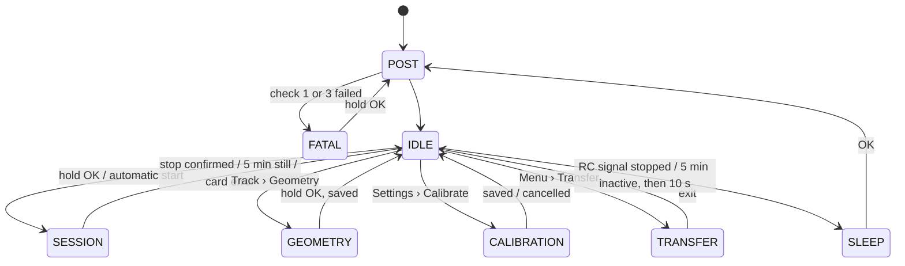

# RC Telemetry — user interface overview

A one-page summary of how the on-car device is driven: the decisions behind it, the keys, the board
states and the screens. **[PLAN-ESP32.md](PLAN-ESP32.md) §3 is authoritative** — when the two
disagree, §3 wins and this file is corrected. The steps that build it are Phases 2 and 3 of
[ROADMAP.md](ROADMAP.md).

## Decisions

| Topic | Decision | Where |
| --- | --- | --- |
| Input | **E-Switch JS5208** five-way switch on one ADC pin (D0) through a resistor ladder; **two buttons** (OK, NAV) on the same ladder until it is fitted | §3.1 |
| Structure | A **Home** screen and a **list menu** | §3.4 |
| Settings | Only the **car profile** and the **display** (brightness, dim delay, text size) are edited on the device, and a **New car** profile can be added there; everything else lives in `/config.json` on the card, mirrored to LittleFS | §3.8 |
| Tracks | Found by position, never registered beforehand; **New track** starts a fresh one at a known venue, for a new layout | §7.1 |
| Text | Two sizes, both 21 columns: **small** (5x8) and **large** (6x13B, the default, picked on the bench). Content longer than the body scrolls | §3.2 |
| Sessions | **Automatic** start (moving, or throttle off neutral) and stop (5 min standing still), plus **manual** start and stop. Switching the car off switches the device off: end the session first; the next boot closes one left open | §3.6, §4.5 |
| Confirmations | Stopping a session by hand, overwriting a start line, overwriting a calibration, deleting sessions | §3.1 |
| Errors | Stay on screen **until a key is pressed**; the warning mark stays while the condition lasts | §3.2 |
| Calibration | A procedure under Settings, per **car profile** (up to 8); no boot gesture | §3.8 |
| Sleep | Only off the car's power, from IDLE: the RC signal stopping, or 5 min with nothing, then 10 s of notice; **OK** wakes | §4.5 |
| BLE | **Only in Transfer mode**: no live stream, no radio near the receiver while driving | §7.4 |

## Keys

| Key | Five-way switch | Two buttons (interim) |
| --- | --- | --- |
| Move the cursor, change page | UP / DOWN, repeating when held | NAV short (lists wrap around) |
| Open, choose | OK short or RIGHT | OK short |
| Back; cancel an editor | The **Back** entry that ends every list and editor; OK on an information screen; LEFT | The same, or NAV held 1 s |
| Perform the screen's action, confirm | OK held 1.5 s, with a hold bar from 300 ms | Same |
| Close a full-screen error | Any key | Any key |

A confirmation dialog is always the same: hold OK = yes; any other key, or 10 s, = no. After 30 s
without a key a menu falls back to Home and the display dims; the press that brightens it does
nothing else.

## Board states

| State | Entered | Left | Keys |
| --- | --- | --- | --- |
| **POST** | Power-on, or a wake from deep sleep | → IDLE; → FATAL when PSRAM or the card fails | Dead |
| **FATAL** | Check 1 or 3 failed | Hold OK → POST | Hold OK only |
| **IDLE** | End of the POST; a session closed; a mode left | → SESSION, GEOMETRY, CALIBRATION, TRANSFER, SLEEP | Navigation |
| **SESSION** | Hold OK on Home or Session; the automatic start | Stop confirmed, 5 min still, card error → IDLE | OK = marker, hold OK = stop, UP/DOWN = page |
| **GEOMETRY** | Hold OK on Track › Geometry | Hold OK = stop and save | Hold OK |
| **CALIBRATION** | Hold OK on Settings › Calibrate, with an RC signal | Saved, or cancelled at the first step | OK = capture, LEFT = back, DOWN = skip aux |
| **TRANSFER** | OK on Menu › Transfer | OK or LEFT, confirmed while a USB host is attached | OK, LEFT |
| **SLEEP** | From IDLE: the RC signal stopping, or 5 min with no RC, no USB, no key — both after a 10 s notice any key cancels | OK → POST | OK wakes |

The automatic start acts from IDLE only, never in GEOMETRY, CALIBRATION or TRANSFER. A USB host keeps
the device out of SLEEP. BLE exists only inside TRANSFER.



## Screens

With **large** text, the default, every screen after the POST has a one-line **status bar** in the
yellow band — the state, the fix, and the warning, USB and BLE marks — then **three body rows**
in the large font and the **key hint** in the small one. Toasts — confirmations only, never a refusal,
which takes the body until a key — take the last body row for 1.5 s, and
a thin scroll bar on the right edge shows when there is more: NAV turns the page. **Small** text
gives two status lines (adding the car profile and free space) and five body rows.

```text
HOME (IDLE), page 1      MENU                     SESSION, page 1
Ready       3D14         Menu        3D14         REC 12:34   3D14
Track N4512E00934        > Session                Lap 12
Start line: set            Track                  Last   1:02.341
Last  1:02.341  L12        GNSS                   Best   0:58.902
OK menu  hold: start     < back   OK open         OK mark  hold: stop
```

| Screen | Content |
| --- | --- |
| **POST** | One check per line as they run; a fatal failure with `hold OK: retry` |
| **Home** | Track, start line, last and best lap, automatic start on or off; hold OK starts a session |
| **Menu** | Session · Track (Start line, Geometry, Info, New track) · GNSS · Transfer · Settings (Car profile and New car, Calibrate, Display, Require fix, Delete sessions, About, Restart) |
| **Session** | Three pages: laps · GNSS · steering and throttle inputs |
| **Calibration** | Six steps — neutral, left, right, full throttle, full brake, aux — then a summary to save |
| **Geometry** | Distance, laps, points; hold OK stops and saves |
| **Transfer** | USB host and BLE state, `Eject on host first` |
| **Dialog** | The question, `hold OK: yes`, `other key: no (10s)` |
| **Error** | `Card lost`, `Write error` or `Card full`, with `any key: close` |
| **Sleep notice** | `Car switched off` or `Nothing for 5 min`, `Sleep in N s`; any key cancels |

The full catalogue — every menu entry with what it shows and does, and the rest of the mockups — is
§3.4 of PLAN-ESP32.md.
