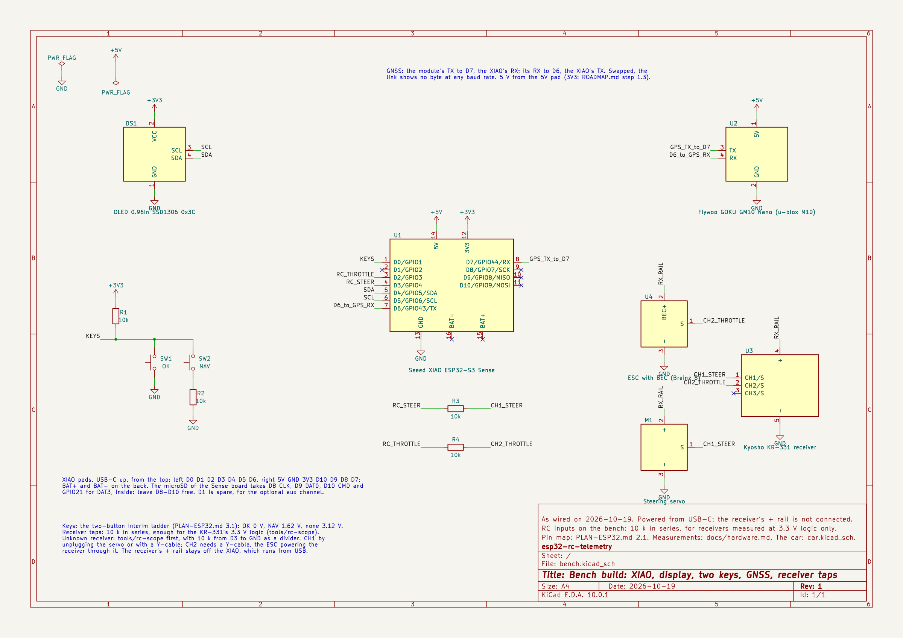
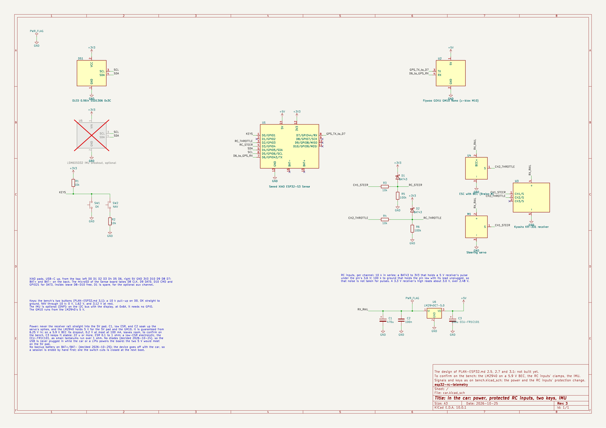

# Hardware

KiCad schematics of the device, one sheet each:

| Sheet | What | Status |
| --- | --- | --- |
| [`bench.kicad_sch`](bench.kicad_sch) ([PDF](bench.pdf)) | The bench build: the XIAO, the display, the two keys, the GM10, and the taps on the receiver's channels | **As wired** on 2026-10-19 |
| [`car.kicad_sch`](car.kicad_sch) ([PDF](car.pdf)) | In the car: the power path from the receiver rail through an LM2940CT-5.0, no diodes and no backup battery, the RC inputs through 10 k with a BAT43 clamp and 100 k down, the two keys, the optional IMU (not fitted, DNP) | **Planned**, from PLAN-ESP32.md §2.5, §2.7 and §3.1. Rev 2, 2026-10-24: the LM2940 in place of the buck, the clamps in place of the 74LVC2G17, the bench's two keys in place of the JS5208. Rev 3, 2026-10-25: the backup LiPo on BAT+/BAT− taken out |





The signals are the same on both sheets, with the names of `firmware/include/pins.h`: `KEYS` on D0,
`RC_THROTTLE` on D2, `RC_STEER` on D3, `SDA` and `SCL` on D4 and D5, and the GNSS UART as
`D6_to_GPS_RX` and `GPS_TX_to_D7`. Those two are named for where they go because a swapped pair
looks like a dead module (`docs/hardware.md`). The car sheet changes the power and the RC inputs'
protection; anything else differs only because a part is not on the bench yet.

## Wiring pictures

Drawings of where each wire goes, in Italian, for building rather than for checking nets: the
sheets above remain the reference.

| Picture | What |
| --- | --- |
| [`wiring-bench.png`](wiring-bench.png) | The bench as wired today: each channel's signal from a Y-cable through 10 k to D2 or D3, one receiver − to GND, no receiver +; the keys, the display and the GM10, all on the USB's power |
| [`wiring-car.png`](wiring-car.png) | The car, as `car.kicad_sch`: power from the receiver's free VCC port through the LM2940CT-5.0, the Y-cables on CH1 and CH2, the RC inputs' protection, the keys, the display and the GM10 |

`gen_wiring.py` writes `wiring-bench.svg` and `wiring-car.svg`, which share their parts; edit it
and run it again rather than the SVGs. Each `.png` is rendered from its `.svg`:

```sh
cd hardware && python3 gen_wiring.py .
rsvg-convert -w 2550 wiring-car.svg > wiring-car.png      # and wiring-bench
```

## Perfboard layout

[`perfboard-car.png`](perfboard-car.png) places the car build on an EPLZON 50.8 × 38.1 mm
solderable breadboard, hole by hole, in Italian: the parts from above, the wires on the copper side,
the wires up to the parts held by the enclosure's lid, and the assembly notes. The receiver plugs into
two 2-pole JST-PH side-entry headers, J1 for BEC+ and GND and J2 for CH1 and CH2.

`gen_perfboard.py` writes `perfboard-car.svg`, and checks the layout first, stopping at the first
problem: every lead in a free hole, no two bodies in the same space (the lid's parts included), one
net per strip, and the strips joined into exactly the nets of `car.kicad_sch`. Edit the script and
run it again rather than the SVG:

```sh
cd hardware && python3 gen_perfboard.py .
rsvg-convert -w 2400 perfboard-car.svg > perfboard-car.png
```

## Enclosure

[`enclosure-car.solidcraft`](enclosure-car.solidcraft) is the SolidCraft design of the car's
enclosure, printed in PETG, with the perfboard's parts, leads and wires modelled in place. It is
56.7 × 43.1 × 26.5 mm, 70.7 mm wide across the zip-tie tabs. The enclosure has these parts:

- **Tub:** floor, walls, four zip-tie tabs, and a slot at the back for the receiver's wires.
- **Lid:** a flat top 4.4 mm thick with the display's window and the two keys in holes through it.
  Underneath, it carries the display, the GM10 (Flywoo's own 3D model, embedded in the design) in a
  frame on foam tape with a clamp bar below it, and the FPC antenna on a front flap.
- **Hatch:** slides down from above, beside the lid, into two vertical dovetail guides on the left
  wall, and snaps shut over the USB-C port and the microSD card. Push it up by its grooves to open
  it.

Three M2 screws go up through the floor and the board into brass inserts in the lid's posts, and
hold the three together. A tongue of the lid closes the back slot and clamps the receiver's wires.
`gen_perfboard.py`'s `LID` list repeats the footprints of what the lid holds, so that a change of
layout is checked against them: keep the two in step.

[`stl/`](stl) holds the parts to print, exported from the design; export them again after a change.
All print in PETG with no supports, at 0.2 mm layers and at least 4 perimeters:

| Part | File | Orientation |
| --- | --- | --- |
| Tub | `vasca.stl` | Upright, floor on the bed |
| Lid | `piastra.stl` | Upside down, top on the bed |
| Hatch | `sportellino.stl` | Outer face on the bed |
| Keys | `tasto-nav.stl`, `tasto-ok.stl` | Upside down, lettering on the bed |
| GM10 clamp | `fermo-gm10.stl` | Flat |

Screws and heat-set inserts, all M2. The holes are the design's parameters `ins_d`,
`ins_small_d`, `ins_depth` and `post_foot_d`, so a test print can settle them:

| Where | Screws | Inserts |
| --- | --- | --- |
| Tub, board and lid | 3 × M2×8, from below | 3 × 4 mm long, 3.45 mm across, in the lid's posts |
| Display | 4 × M2×6, from below through its slots | 4 × 4 mm long, 3.2 mm across, from the lid's top |
| GM10 clamp | 1 × M2×4 | 1 × 4 mm long, 3.2 mm across, in the clamp's post |

The keys go up through their holes in the lid from below before the board is screwed on, and a
flange under the lid keeps them in. Each sits on its switch by a cap over the switch's stem, so it
cannot slip off it, with 0.3 mm free above. Two parameters of the design fit them to the real
switches: `key_stem_d`, the stem's diameter near its tip (the cap's hole is 0.4 mm wider), and
`key_play`, to raise if a key stays pressed because its switch is taller than modelled.

## Assembly guide

[`assembly-car.pdf`](assembly-car.pdf) is the step-by-step guide to building the car device, in
Italian. It covers:

- the inserts;
- the perfboard, soldered in a buildable order with a drawing per step, and a 5 V test before the
  XIAO;
- the lid's parts and the wires between lid and board;
- closing the box, the receiver's wiring and the first start.

`gen_assembly.py` writes it from `gen_perfboard.py`'s data and the pictures in
[`assembly/img/`](assembly/img). Edit the script and run it again rather than the HTML; `--pdf`
prints the PDF through headless Google Chrome:

```sh
cd hardware && python3 gen_assembly.py --pdf
```

The pictures are renders of `enclosure-car.solidcraft`. For each picture, the printed parts were
given opaque colours and the other bodies shown or hidden; the design was then reopened from disk,
so none of that is saved. Two pictures, `02-piastra-sotto-raw.jpg` and `04-piastra-mappa-raw.jpg`,
are straight views of the lid from below. The script places their numbered markers from the model's
coordinates through the camera written in `project()`. After a change to the lid, render both again
from that camera.

## Reading and editing

Open a `.kicad_sch` in KiCad's Schematic Editor; the sheets are checked with KiCad 10.0.1. The
symbols are embedded, so no library setup is needed. The modules — XIAO, display, GM10, receiver,
ESC, servo, IMU breakout — are drawn as boxes in a library named `rct`. Power is on
top of each box, ground below, and the signals on its sides. The LM2940CT-5.0 is in `rct` too: it is
KiCad's `LM7805_TO220` under its own name, as the two share their TO-220 pins, 1 IN, 2 GND, 3 OUT. The XIAO's pin numbers are its pads, so
the box does not show where the pads are; a note on each sheet gives their order on the board.

Connections are made by net labels, so a net is every pin that touches a label of its name. In
KiCad's Schematic Editor, highlighting a net shows them all.

## Checking after a change

Electrical rules, then the nets themselves, then the exports:

```sh
K=/Applications/KiCad/KiCad.app/Contents/MacOS/kicad-cli
$K sch erc -o /tmp/erc.rpt hardware/bench.kicad_sch    # and car
$K sch export netlist --format kicadsexpr -o /tmp/bench.net hardware/bench.kicad_sch
$K sch export pdf -o hardware/bench.pdf hardware/bench.kicad_sch
$K sch export svg -o /tmp/ hardware/bench.kicad_sch && rsvg-convert -w 2400 -b white /tmp/bench.svg > hardware/bench.png
```

The ERC run from the command line warns that the libraries `power`, `Device`, `rct` and the others
are not configured. Those warnings are expected: the symbols are embedded. Anything else in the
report is a real problem.

The ERC is not enough on its own. A wire that ends on another wire's end joins the two nets
silently: an early version of the car sheet had BAT+ on ground that way, with a clean ERC. Read the
netlist after any change of layout, and check that every power net holds only the pins it should.

`gen_schematics.py` wrote the first version of both sheets from KiCad's libraries. Running it again
overwrites the sheets, edits made in KiCad included, so edit in KiCad from now on. The car sheet's
revs 2 and 3 are the exception: that sheet had never been edited in KiCad, so it was generated
again, with the UUIDs of what did not change kept. To do the same, run the script into a scratch
directory and copy only the sheet you mean, or it overwrites the other one too.
